# 📘 Saathi Code Guide: every piece of code, explained simply

> **Who this is for:** anyone who wants to understand how Saathi's code works, even if you're
> new to programming. No jargon without an explanation. Lots of pictures.
>
> **Last updated:** Phase 1 complete (2026-11-18). This guide grows with every phase. See
> [How to keep this guide up to date](#-how-to-keep-this-guide-up-to-date).

---

## 🧭 Contents

1. [What Saathi is (in one minute)](#1--what-saathi-is-in-one-minute)
2. [The big picture](#2--the-big-picture)
3. [How the code is organised: the restaurant analogy](#3--how-the-code-is-organised-the-restaurant-analogy)
4. [Folder map](#4--folder-map)
5. [Journeys: what happens, step by step](#5--journeys-what-happens-step-by-step)
6. [Data: where it lives and how it moves](#6--data-where-it-lives-and-how-it-moves)
7. [Code reference: every class and function](#7--code-reference-every-class-and-function)
8. [Bot Studio (dashboard) and the widget](#8--bot-studio-dashboard-and-the-widget)
9. [Database migrations](#9--database-migrations)
10. [Tests: how we prove it works](#10--tests-how-we-prove-it-works)
11. [Servers, deploys and scripts](#11--servers-deploys-and-scripts)
12. [Built vs. planned, by phase](#12--built-vs-planned-by-phase)
13. [Glossary](#13--glossary)
14. [How to keep this guide up to date](#-how-to-keep-this-guide-up-to-date)

### Symbols used

| Symbol | Meaning |
|---|---|
| 🟢 | Built and working |
| 🟡 | Skeleton: the file exists, the real work arrives in a later phase |
| 🔒 | Security-relevant: read carefully before changing |
| ➡️ | "calls" or "sends data to" |

---

## 1. 💡 What Saathi is (in one minute)

Saathi is a **chatbot platform for businesses** (we call each business a **tenant**).

- A business owner logs in to **Bot Studio** (the dashboard) and creates a **bot**.
- They give it a **personality**, **branding** (colours, title, greeting) and later **documents** to learn from.
- The bot appears as a **chat widget** on their website (and later on WhatsApp and voice).
- Visitors ask questions in **English, Hindi or Bengali**; the bot answers from the business's documents.

One Saathi installation serves **many businesses at once**, and each business must **never** see
another's data. That rule shapes almost everything in the code.

---

## 2. 🗺️ The big picture

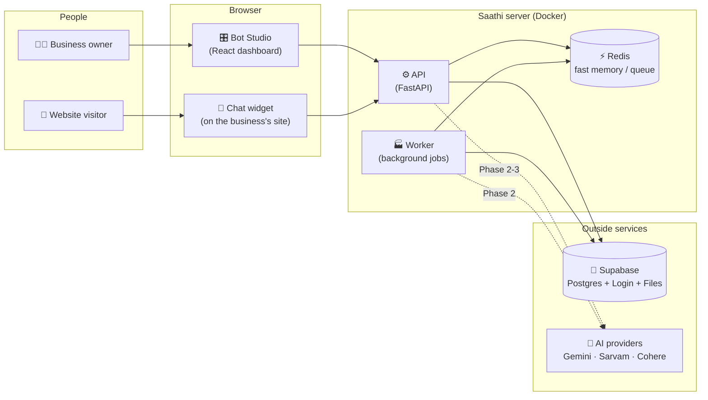

| Part | Plain explanation |
|---|---|
| **Bot Studio** | The website where business owners set up their bots |
| **Widget** | The little chat bubble on the business's website |
| **API** | The "brain" that answers every request from Studio and the widget |
| **Worker** | A helper that does slow jobs in the background (e.g. reading PDFs), so nobody waits |
| **Redis** | Very fast temporary memory: job queue, recent chat turns, rate limits |
| **Supabase** | Holds the real data (database), handles logins, stores files |
| **AI providers** | Gemini writes answers and makes "embeddings", Sarvam does speech, Cohere ranks search results |

---

## 3. 🍽️ How the code is organised: the restaurant analogy

Think of the backend as a restaurant:

| Restaurant | Code folder | What lives there |
|---|---|---|
| 📜 **The recipes** (rules that never change) | `domain/` | Business rules: what a valid bot or config looks like. Plain Python only |
| 🧾 **The shopping list** ("we need flour", not "buy from shop X") | `ports/` | Small "contracts" describing what the code needs from the outside world |
| 👨‍🍳 **The chef** (does one dish = one task) | `application/` | Use cases: "create a bot", "publish a config" |
| 🚚 **The suppliers** (real shops) | `adapters/` | Real implementations: database code, Gemini, Supabase |
| 🧑‍💼 **The waiter** (takes orders) | `api/` | HTTP endpoints: receives requests, returns responses |
| 🏢 **The building** (water, power) | `platform/` | Shared plumbing: settings, database connection, security, logging |
| 🧑‍🏭 **The manager** (decides which supplier) | `bootstrap/` | Wires everything together at startup |

**The golden rule:** arrows only point **inward**. The recipes never know about the waiter or the
suppliers. That keeps business rules safe and testable.

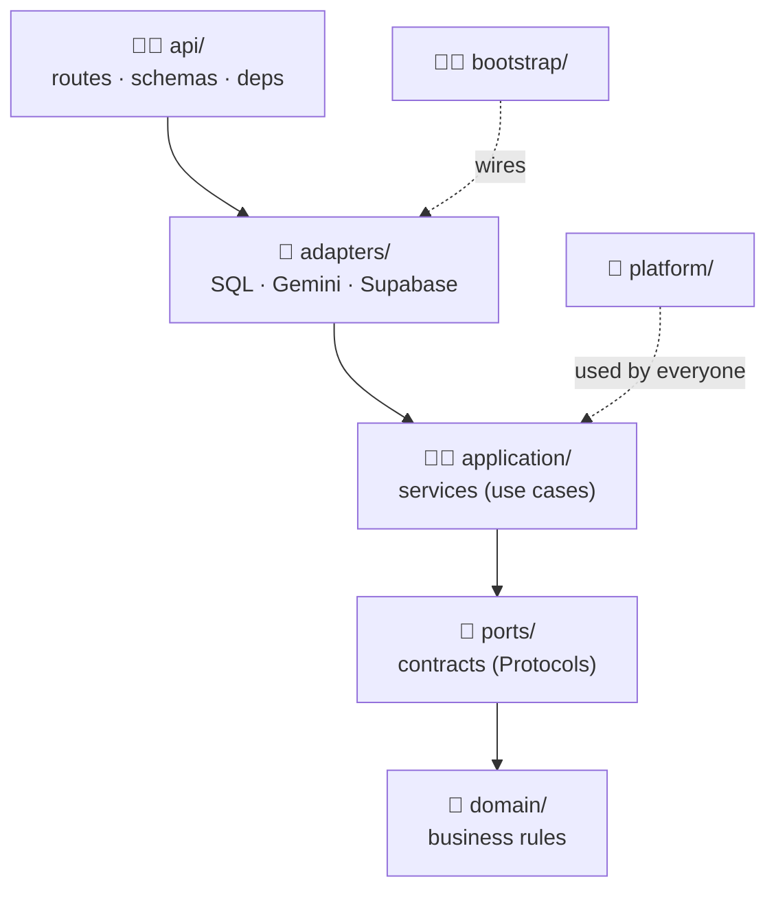

These rules are enforced automatically by a tool called **import-linter** (it fails CI if
someone breaks them). The full rulebook is in [`REPO_STRUCTURE.md`](REPO_STRUCTURE.md).

### Modules: the restaurant's departments

The backend is split into **modules**. Each has its own folders (domain, ports, …) and modules
**never import each other** (rule R4).

| Module | Job | Status |
|---|---|---|
| `tenancy` | Businesses, bots, bot configuration, logins → workspace | 🟢 Phase 1 |
| `credentials` | Businesses' own AI keys, stored encrypted | 🟡 logic ready, endpoints Phase 8 |
| `knowledge` | Documents, chunks, search (embeddings + reranking) | 🟡 adapters ready, flow Phase 2 |
| `conversation` | Chat: prompts, AI answers, memory | 🟡 adapters ready, flow Phase 3 |
| `channels` | Web widget, WhatsApp, voice, speech | 🟡 adapters ready, flow Phase 4 |
| `handoff` | Pass a chat to a human agent | 🟡 table only, Phase 5 |
| `leads` | Capture customer details | 🟡 table only, Phase 5 |
| `analytics` | Usage and cost tracking | 🟡 table only, Phase 5–6 |

---

## 4. 📁 Folder map

```
chatbot-platform/
├── backend/                     ⚙️ the API + worker (Python)
│   ├── src/saathi/
│   │   ├── main.py              🚪 starts the web app
│   │   ├── worker.py            🏭 starts the background worker
│   │   ├── api/                 🧑‍💼 shared HTTP pieces (health, errors, middleware, deps, router)
│   │   ├── bootstrap/           🧑‍🏭 wiring (container, providers, credentials)
│   │   ├── platform/            🏢 shared plumbing (config, db, security, logging, storage…)
│   │   └── modules/             🏬 the departments (tenancy, knowledge, conversation…)
│   ├── migrations/              🗄️ database changes (Alembic) + schema.sql
│   └── tests/                   🧪 unit, contract, integration, security, architecture
├── dashboard/                   🎛️ Bot Studio (React + TypeScript)
├── widget/                      💬 the chat bubble (placeholder until Phase 4)
├── infra/                       🐳 Docker Compose files (dev + production)
├── scripts/                     🛠️ helper scripts (key checks, VPS setup, live test)
├── docs/                        📚 plans, decisions (ADRs), runbooks, this guide
└── .github/                     🤖 CI pipeline, Dependabot, PR template
```

---

## 5. 🚶 Journeys: what happens, step by step

### 5.1 🚀 The app starts

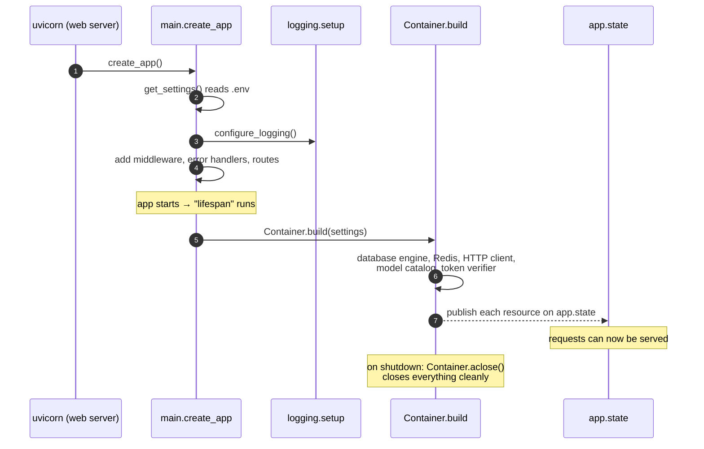

**In plain words:** when the server starts, it reads settings, sets up logging, and builds one
**container** holding the shared tools (database connection, Redis, HTTP client…). Every request
borrows these tools; nobody creates their own.

### 5.2 📨 Every request (the common path)

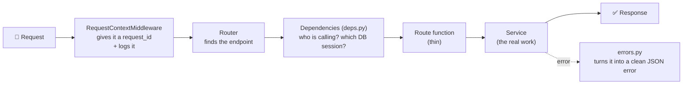

Every response carries an `x-request-id` header, so one request can be followed through the logs.

### 5.3 🔐 Logging in: how the API knows who you are

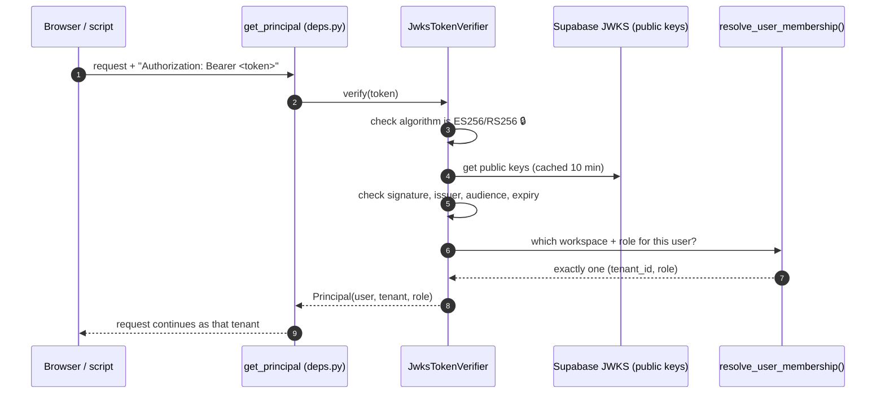

| Situation | Result |
|---|---|
| No token | **401** "missing bearer token" |
| Bad / expired / forged token | **401** "invalid or expired token" |
| Valid login but no workspace | **403** |
| Valid login, in two workspaces | **403** (we never guess) |
| No verifier configured (local dev without `AUTH_*`) | **401** for every `/api/v1` call (fail closed 🔒) |

### 5.4 🤖 Creating a bot

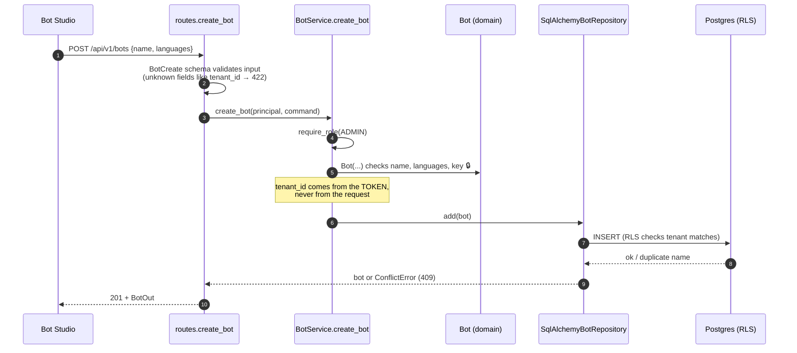

### 5.5 📝 Save draft → publish → rollback (bot configuration)

A bot's settings are stored as **versions**. You never edit a version; you create a new one.

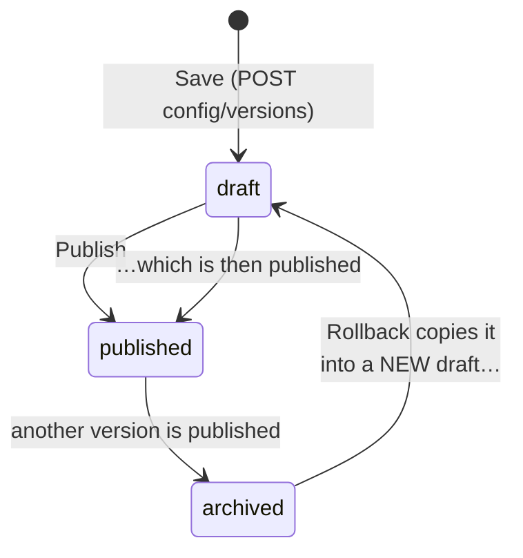

| Step | What the code does |
|---|---|
| **Save draft** | `BotConfigService.save_draft` checks the role, that the bot exists, that the chosen model is on the tenant's plan, then stores version N+1 as `draft` |
| **Publish** | `BotConfigService.publish` archives the current live version and publishes the target, in **one transaction**. A database rule allows only **one** published version per bot; if two publishes race, one gets **409** |
| **Rollback** | `BotConfigService.rollback` copies an old version into a new draft and publishes it. History is never rewritten |

### 5.6 💬 The widget loads its look (public, no login)

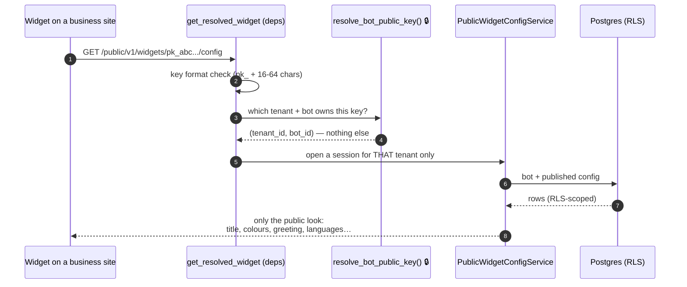

- Unknown key **and** bot without a published config both return the **same 404**, so outsiders
  can't discover which keys exist.
- The response never contains prompts, model names, plan or internal IDs (rule R10).
- It may be cached by browsers for 60 seconds.

### 5.7 ❤️ Health and readiness

| Endpoint | Question it answers | Checks |
|---|---|---|
| `GET /health` | "Is the app alive?" | Nothing external, always fast |
| `GET /ready` | "Can it serve traffic?" | Database + Redis, 2 s timeout each; returns only `ok`/`fail` |

### 5.8 🏭 Background jobs (worker)

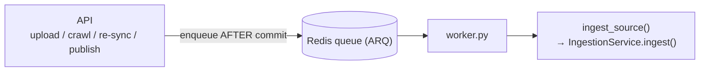

`worker.py`'s `startup` builds the `Container` and the `IngestionService` once (storage, parsers,
crawler and embedder are built right away, so missing keys stop the worker at startup instead of
failing every job). A job is retried up to 5 times (`max_tries`), only for temporary provider
problems, with a growing wait (`retry_delay_seconds`: 10 s, 20 s, 40 s… max 5 min, plus jitter).
Each job gets at most 600 seconds and at most 4 run at once (parsing and OCR are heavy and the
VPS is shared with n8n). `shutdown` closes the container's connections.

### 5.9 📤 A document becomes searchable (Phase 2)

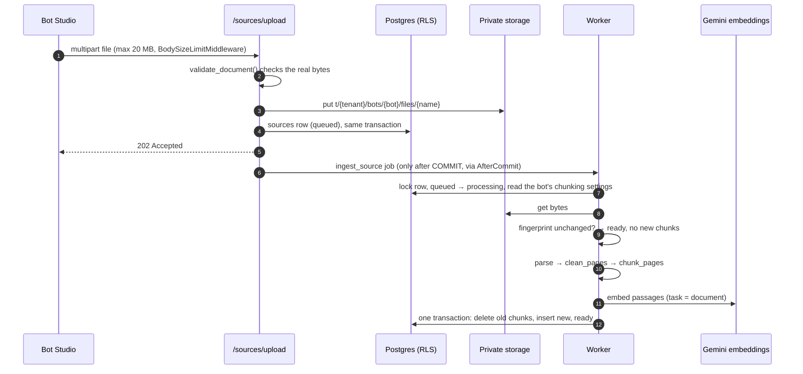

Websites work the same way through `/sources/crawl`: the worker calls `HttpCrawler` instead of
reading storage. Every request it makes goes through `fetch_public_url` (🔒 SSRF guard).
Re-uploading a file with the same name replaces that source; if the bytes, the bot's chunk
settings and the embedding model are all unchanged, the fingerprint matches and **zero** new
chunks are written (Phase 2 exit criterion).

### 5.10 💡 A question gets a cited answer (Phase 2: evals; Phase 3: the chat)

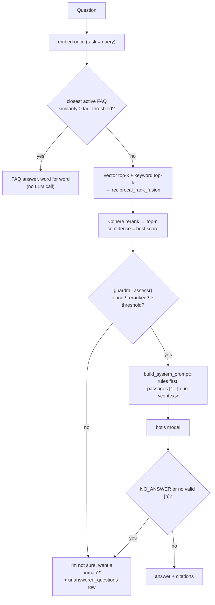

A provider that is down never crashes the reply: no embeddings, no reranker scores or no LLM
all lead to the "I'm not sure" path, and the question is logged with reason
`provider_unavailable`.

### 5.11 🔁 Publishing new chunk settings re-processes documents

`BotConfigService.publish` calls the `ConfigPublishedHook` (bootstrap's
`RequeueSourcesOnChunkingChange`) inside the publish transaction. If `chunk_size_tokens` or
`chunk_overlap_ratio` changed (`RetrievalSettings.chunking_differs`), every ready/failed source of
the bot is put back in the queue and its job is sent after the commit. A source that is being
processed at that moment notices the change when it finishes and queues itself again.

---

## 6. 🗃️ Data: where it lives and how it moves

### 6.1 Where each kind of data lives

| Data | Lives in | Why there |
|---|---|---|
| Businesses, bots, configs, chats, documents' chunks | **Supabase Postgres** | Permanent, protected by row-level security |
| Logins (users, passwords) | **Supabase Auth** | We never store passwords ourselves |
| Uploaded files, logos | **Supabase Storage** (Phase 2/4) | Big files don't belong in the database |
| Job queue, recent chat turns, rate limits | **Redis** | Fast, temporary |
| Secrets (keys, passwords) | **`.env` file** on the server, never in git | 🔒 |
| Businesses' own AI keys (Phase 8) | Postgres, **encrypted** (AES-256-GCM) | 🔒 even a database leak doesn't reveal them |

### 6.2 🔒 How tenants are kept apart (row-level security)

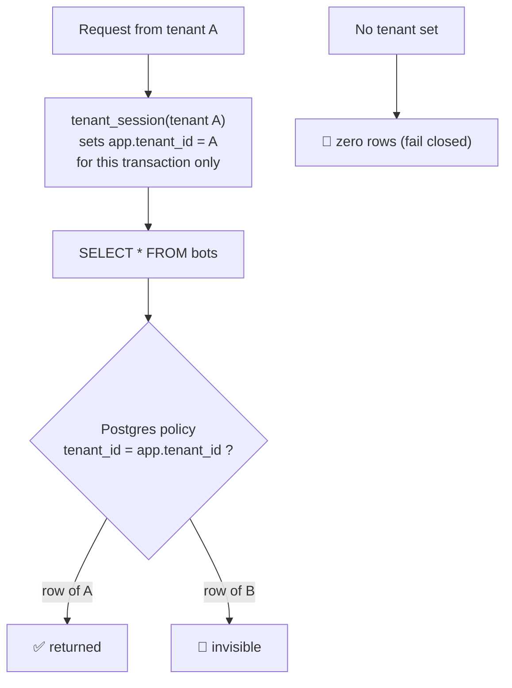

Three walls protect every tenant:
1. **The code** always filters by `tenant_id` (rule R15).
2. **The database** hides other tenants' rows (forced row-level security), even if the code forgets.
3. **Composite foreign keys**: a row can't even *point at* another tenant's bot.

The app connects as the limited user `saathi_app`, which can't switch these walls off. Only
migrations use the owner account.

### 6.3 The tables (17)

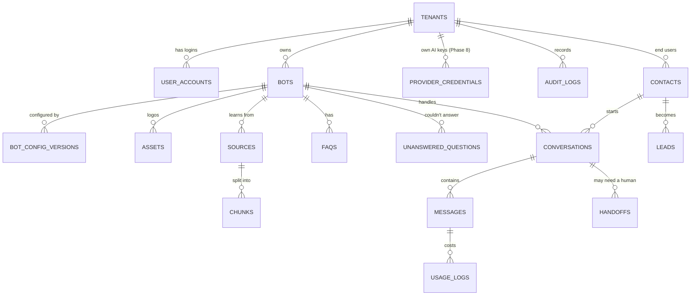

| Table | Stores | Module |
|---|---|---|
| `tenants` | One row per business: name, plan, monthly token cap | tenancy |
| `user_accounts` | Which login belongs to which business, with which role | tenancy |
| `bots` | Each bot: name, persona, languages, public key | tenancy |
| `bot_config_versions` | Every saved configuration (draft / published / archived) | tenancy |
| `assets` | Logo files (the row stores the file's address, not the file) | tenancy |
| `audit_logs` | "Who did what" (append-only) | tenancy |
| `provider_credentials` | Businesses' own AI keys, encrypted | credentials |
| `sources` | Uploaded documents / websites, processing status, fingerprint, crawl settings (`options`) | knowledge |
| `chunks` | Small passages of documents + their embedding (meaning search) and `tsv` (keyword search) | knowledge |
| `faqs` | Question/answer pairs + the question's embedding (FAQ override) | knowledge |
| `unanswered_questions` | Questions the bot said "I'm not sure" to, and why (Studio screen in Phase 5) | conversation |
| `contacts` | End users (website visitor, WhatsApp number) | conversation |
| `conversations` | One chat session | conversation |
| `messages` | Each message in a chat | conversation |
| `handoffs` | Chats passed to a human | handoff |
| `leads` | Captured customer details | leads |
| `usage_logs` | Tokens and cost per AI call | analytics |

---

## 7. 📚 Code reference: every class and function

How to read each table: **Name** → **what it is** → **plain explanation**. Inside a class,
methods are listed after the class name.

### 7.1 🚪 Entry points

#### `main.py`
| Name | Kind | Plain explanation |
|---|---|---|
| `create_app` | function | Builds the whole web app: reads settings, sets up logging, adds middleware (request ids, CORS), error handlers and all routes. Its `lifespan` builds the `Container` at startup and closes it at shutdown |

#### `worker.py`
| Name | Kind | Plain explanation |
|---|---|---|
| `startup` | function | Runs when the worker starts; loads settings into the job context |
| `shutdown` | function | Runs when the worker stops (nothing to clean up yet) |
| `WorkerSettings` | class | Tells ARQ (the job runner) which jobs exist (`ingest_source`), where Redis is, max 5 tries, 600 s per job, 10 jobs at once |

### 7.2 🧑‍💼 Shared API pieces (`api/`)

#### `api/router.py`
| Name | Kind | Plain explanation |
|---|---|---|
| `build_api_router` | function | Collects every route: `/health`, `/ready`, `/api/v1/...` (login required) and `/public/v1/...` (widget) |

#### `api/health.py`
| Name | Kind | Plain explanation |
|---|---|---|
| `health` | function | `GET /health` → `{"status":"ok"}`. Proves the app is alive; touches nothing else |
| `_run` | function | Runs one readiness check with a 2-second limit; logs only the error type, never details 🔒 |
| `ready` | function | `GET /ready` → runs all checks (database, Redis) at once; `200 ready` or `503 not_ready` |
| `ReadinessCheck` | type alias | "A function that checks one dependency" |

#### `api/middleware.py`
| Name | Kind | Plain explanation |
|---|---|---|
| `RequestContextMiddleware` | class | Wraps every request: gives it a `request_id` (or accepts a safe one from the caller), adds it to every log line and the response header, and logs one `http.request` line (method, path, status, duration). Never logs query strings 🔒 |
| `BodySizeLimitMiddleware` | class | 🔒 Refuses an upload with no declared size (411) or over the limit (413) **before** anything reads the body, and counts the bytes actually received. Only for the paths it is given (`/sources/upload`) |

#### `api/errors.py`
| Name | Kind | Plain explanation |
|---|---|---|
| `_status_for` | function | Maps our error types to HTTP codes (e.g. `NotFoundError` → 404) |
| `_body` | function | Builds the one standard error shape: `{"error": {code, message, request_id}}` |
| `register_error_handlers` | function | Installs handlers so **every** failure (our errors, bad input, unknown route, crashes) returns that clean shape with no stack traces 🔒 |

| Our error | HTTP |
|---|---|
| `ValidationError` | 422 |
| `NotFoundError`, `TenantIsolationError` | 404 |
| `ConflictError` | 409 |
| `AuthenticationError` | 401 |
| `AuthorizationError` | 403 |
| `RateLimitError` | 429 |
| `ProviderTimeoutError` / `ProviderError` | 504 / 502 |
| anything else | 500 "An internal error occurred." |

#### `api/deps.py` (shared "dependencies" that routes ask for)
| Name | Kind | Plain explanation |
|---|---|---|
| `get_sessionmaker` | function | Hands out the database session factory |
| `get_token_verifier` | function | Hands out the login checker (or nothing, if login isn't configured) |
| `get_model_catalog` | function | Hands out the list of AI models tenants may choose |
| `get_http_client` | function | Hands out the shared outbound HTTP client |
| `get_principal` | function | 🔒 Reads the `Authorization` header, verifies the token, returns **who is calling** (user, tenant, role). Missing token or no verifier → 401 |
| `get_tenant_db` | function | 🔒 Gives a database session already locked to the caller's tenant (row-level security) |
| `PrincipalDep`, `TenantDbDep`, `HttpClientDep` | shortcuts | Ready-made "give me this" labels used by routes |
| `get_after_commit` / `AfterCommitDep` | function / shortcut | One `AfterCommit` list per request; `get_tenant_db` runs it right after the commit (never after a rollback) |
| `get_job_pool` | function | Hands out the shared ARQ (Redis) job-queue connection |

### 7.3 🧑‍🏭 Wiring (`bootstrap/`)

#### `bootstrap/container.py`
| Name | Kind | Plain explanation |
|---|---|---|
| `Container` | class | The "toolbox" built once per process: settings, database engine + sessions, Redis, HTTP client, model catalog, token verifier |
| `Container.build` | method | Creates all the tools from the settings |
| `Container.readiness_checks` | method | Says which checks `/ready` runs (database, Redis) |
| `Container._ping_database` / `_ping_redis` | methods | Each does one tiny round trip to prove the dependency answers |
| `Container.aclose` | method | Closes everything at shutdown |
| `build_token_verifier` | function | 🔒 Builds the Supabase login checker if `AUTH_*` are set. In staging/production, missing settings **stop the app from starting** |
| `Lazy` | class | Builds a vendor client on first use and keeps it (`document_store`, `embedder`, `reranker`, `crawler`, `parsers`), so the API starts without every key and the feature fails closed when used |

#### `bootstrap/providers.py` (picks which vendor to use)
| Name | Kind | Plain explanation |
|---|---|---|
| `build_llm_resolver` | function | Builds the thing that picks the right AI model + key per bot |
| `build_embedder` | function | Picks the embedding vendor from settings (`gemini` by default) |
| `build_reranker` | function | Picks the reranker (`cohere`) |
| `build_parser` | function | Picks a document parser (`pymupdf`) |
| `build_stt` / `build_tts` | functions | Pick speech-to-text / text-to-speech (`sarvam`) |
| `build_object_store` | function | Picks file storage (`supabase`), private or public bucket |
| `build_parsers_by_extension` | function | Every registered parser, by file extension (`.pdf` → PDF parser); refuses to start if two parsers claim one extension |
| `build_crawler` | function | The website crawler named by `CRAWLER_PROVIDER` (default `http`) |

#### `bootstrap/credentials.py`
| Name | Kind | Plain explanation |
|---|---|---|
| `_reveal` | function | Safely reads a hidden secret value (or nothing) |
| `PlatformCredentialSource` | class | Hands out **Saathi's own** AI keys per provider (Phase 8 adds tenants' own keys) |
| `PlatformCredentialSource.api_key_for` | method | "Give me the key for provider X" |
| `platform_credentials_from_env` | function | Builds the source from the Gemini and Anthropic keys in `.env` |

#### `bootstrap/knowledge_bridge.py` (Phase 2 bridges between modules, R4)
| Name | Kind | Plain explanation |
|---|---|---|
| `TenancyBotDirectory` | class | Knowledge's `BotDirectory`, backed by tenancy: "does this bot belong to this tenant?" |
| `PublishedChunkingPolicySource` / `policy_for` | class | Knowledge's `ChunkingPolicySource`: the bot's **published** chunk settings (defaults before the first publish) |
| `chunking_policy_from` | function | Tenancy's `RetrievalSettings` → knowledge's `ChunkingPolicy` |
| `RequeueSourcesOnChunkingChange` / `on_published` | class | Tenancy's `ConfigPublishedHook`: re-queues the bot's sources when chunk size/overlap changed |
| `KnowledgeRetrieverAdapter` / `retrieve` | class | Conversation's `KnowledgeRetriever`: calls knowledge's lookup and converts the result |
| `build_ingestion_service` | function | Wires the worker's `IngestionService` (SQL unit of work, storage, parsers, crawler, embedder, queue) |
| `build_answer_service` | function | Wires `AnswerService` on one tenant session (evals now, the chat in Phase 3) |

### 7.4 🏢 Shared plumbing (`platform/`)

#### `platform/config/settings.py`
| Name | Kind | Plain explanation |
|---|---|---|
| `Settings` | class | All core settings from `.env`: environment, log level, CORS, database/Redis addresses, login (`AUTH_*`), and which vendor to use for embeddings, reranking, speech and storage |
| `get_settings` | function | Reads the settings once and reuses them |

#### `platform/config/model_catalog.py`
| Name | Kind | Plain explanation |
|---|---|---|
| `ModelOption` | class | One choosable model: key (e.g. `standard`), label, provider, real model id, token limit, which plans may use it |
| `ModelCatalog` | class | The list of allowed models |
| `ModelCatalog.get` | method | Finds a model by key (unknown → error) |
| `ModelCatalog.options_for_plan` | method | Models a plan may use (e.g. starter can't use `advanced`) |
| `ModelCatalog.is_allowed` | method | "May this plan use this model?" |
| `CatalogSettings` | class | Reads model ids from `.env` (`GEMINI_MODEL_SMALL/LARGE`, `ANTHROPIC_MODEL_*`) |
| `default_catalog` | function | Builds the catalog: Gemini owns `standard`/`advanced`; Claude appears as `claude-standard`/`claude-advanced` only if configured |

#### `platform/db/` (database plumbing)
| Name | File | Plain explanation |
|---|---|---|
| `Base` | `base.py` | Parent of every table class; makes all timestamps timezone-aware |
| `uuid_pk` / `tenant_fk` / `created_at` / `updated_at` | `base.py` | Reusable column recipes: id, tenant link, "created at", "updated at" |
| `build_engine` | `engine.py` | Creates the database connection pool |
| `build_sessionmaker` | `engine.py` | Creates the factory that makes database sessions |
| `ping_database` | `engine.py` | One `SELECT 1` to prove the database answers (used by `/ready`) |
| `set_tenant` | `tenant_context.py` | 🔒 Tells Postgres "this transaction belongs to tenant X" (resets at commit) |
| `tenant_session` | `tenant_context.py` | 🔒 Opens a session + transaction already locked to one tenant |
| `violated_constraint` | `errors.py` | Reads which database rule was broken (e.g. duplicate name), so we can return 409 |
| `AfterCommit` | class (`after_commit.py`) | A per-transaction "to do after the save" list (e.g. queue a job). `run()` is called once after COMMIT; a failing item is logged and the rest still run |

#### `platform/errors/errors.py` (our error family)
| Name | Plain explanation |
|---|---|
| `SaathiError` | Parent of all our errors (has a `code` and a `message`) |
| `DomainError` | Parent of business-rule errors |
| `ValidationError` | "Your input breaks a rule" → 422 |
| `NotFoundError` | "Doesn't exist (for you)" → 404 |
| `ConflictError` | "Clashes with something else" (duplicate, race) → 409 |
| `AuthenticationError` | "We don't know who you are" → 401 |
| `AuthorizationError` | "You're not allowed" → 403 |
| `TenantIsolationError` | "That belongs to another tenant" → 404 (and logged as a security event) 🔒 |
| `RateLimitError` | "Too many requests" → 429 |
| `ProviderError` / `ProviderTimeoutError` | An AI vendor failed / was too slow → 502 / 504 |
| `InfrastructureError` / `ConfigurationError` | Something on our side is broken or misconfigured → 500 |

#### `platform/http/client.py`
| Name | Plain explanation |
|---|---|
| `build_http_client` | Creates the **one** shared HTTP client: timeouts, connection limits, never follows redirects 🔒 |
| `FetchedPage` | class (`url_guard.py`) | One response from a safe fetch: status, content type, redirect target (not followed), capped body |
| `is_public_ip` | function (`url_guard.py`) | 🔒 False for private, loopback, link-local (cloud metadata), multicast and reserved addresses, incl. IPv4 hidden in IPv6 |
| `parse_public_url` | function (`url_guard.py`) | 🔒 Only http/https, ports 80/443, no `user:password@`, bounded length |
| `resolve_public_ip` | function (`url_guard.py`) | 🔒 DNS lookup where **every** answer must be public |
| `fetch_public_url` | function (`url_guard.py`) | 🔒 One GET to a tenant-supplied URL, pinned to the checked IP (TLS still checks the real name), no redirects, size and time limits (SSRF protection) |

#### `platform/logging/setup.py`
| Name | Plain explanation |
|---|---|
| `configure_logging` | Makes every log line structured (JSON in production), including uvicorn and library logs; adds `request_id`/`tenant_id`; hides noisy/unsafe logs |

#### `platform/observability/tracing.py`
| Name | Plain explanation |
|---|---|
| `Tracer` | Contract for "record how long each step took": `span(name, …)` wraps one step (Langfuse arrives in Phase 3) |
| `NoopTracer` | A do-nothing tracer used until then (its `span` records nothing) |

#### `platform/providers/registry.py`
| Name | Plain explanation |
|---|---|
| `ProviderRegistry` | A phone book of vendors: adapters `register` themselves by name; the app `create`s one by the name in settings; `available` lists them. Unknown name → clear error |

#### `platform/security/` 🔒
| Name | File | Plain explanation |
|---|---|---|
| `Role` | `auth.py` | viewer < agent < admin < owner |
| `Principal` | `auth.py` | "Who is calling": user id, tenant id, role |
| `TokenVerifier` | `auth.py` | Contract: "turn a token into a Principal, or refuse" |
| `Membership` / `MembershipLookup` | `auth.py` | A (tenant, role) pair / contract for finding a user's memberships |
| `require_role` | `auth.py` | Stops the request with 403 if the role is too low |
| `JwksTokenVerifier` | `jwt_verifier.py` | The real login checker for Supabase tokens (see 5.3) |
| `JwksTokenVerifier.verify` | `jwt_verifier.py` | Checks the token, then finds exactly one workspace |
| `JwksTokenVerifier._verified_claims` | `jwt_verifier.py` | Checks algorithm, signature, issuer, audience, expiry, user id |
| `JwksTokenVerifier._key_for` / `_refresh` | `jwt_verifier.py` | Get the right public key; refresh at most once a minute for unknown keys; keep old keys during outages |
| `JwksTokenVerifier._reject` | `jwt_verifier.py` | Logs why (never the token) and answers 401 with a generic message |
| `AesGcmCipher` | `crypto.py` | Encrypts/decrypts secrets with AES-256-GCM, bound to their owner ("associated data"), with key rotation support |
| `AesGcmCipher.from_env_value` / `encrypt` / `decrypt` / `needs_rotation` | `crypto.py` | Load keys from `.env` / lock / unlock / "was this locked with an old key?" |
| `_b64e` / `_b64d` | `crypto.py` | Small helpers to turn bytes into text and back |
| `redact` | `pii.py` | Masks emails, card numbers, Aadhaar, phone numbers and PAN in text (for logs) |
| `BucketPolicy` / `RedisTokenBucket` | `rate_limit.py` | Rate limiter: "N requests, refilling at R per second"; decides what happens if Redis is down (security limits deny) |
| `RedisTokenBucket.allow` | `rate_limit.py` | "May this subject make one more request?" |
| `ImageInfo` / `sniff_image` / `validate_logo` | `uploads.py` | Checks an upload's **real bytes** (not its name) are PNG/JPEG/WebP and ≤ 512 KB; refuses SVG |
| `DocumentInfo` | class (`uploads.py`) | What an uploaded document really is: content type, extension, safe file name |
| `validate_document` | function (`uploads.py`) | 🔒 PDF/DOCX/XLSX judged by their bytes, TXT/MD/CSV must be strict UTF-8 without NUL bytes, max 20 MB; a renamed file is refused |
| `_sniff_office` | function (`uploads.py`) | 🔒 Reads a .docx/.xlsx zip's table of contents only; refuses zip bombs (over 100 MB unpacked or 5,000 parts) |
| `safe_filename` / `_extension` | functions (`uploads.py`) | 🔒 Drops folders and unsafe characters from a client file name (no `../`, no hidden files) / its lower-case extension |

#### `platform/storage/`
| Name | File | Plain explanation |
|---|---|---|
| `ObjectStore` | `object_store.py` | Contract for file storage: `put`, `get`, `delete`, `public_url` |
| `SupabaseStorageSettings` | `supabase_store.py` | Supabase address, secret key, bucket names |
| `SupabaseObjectStore` | `supabase_store.py` | Real storage on Supabase: private bucket for documents, public bucket for logos |
| `SupabaseObjectStore.put` / `get` / `delete` / `public_url` / `_url` | `supabase_store.py` | Upload / download / delete / public address / build the address |
| `_check_key` | `supabase_store.py` | 🔒 File paths must start with `t/{tenant}/` and can't climb out with `..` |
| `_is_not_found` | `supabase_store.py` | Understands Supabase's two ways of saying "not found" |
| `create_supabase_store` | `supabase_store.py` | Registry factory; refuses to start without URL + key 🔒 |

### 7.5 🏬 Module: `tenancy` (businesses, bots, configs) 🟢

#### Domain (the rules)
| Name | File | Plain explanation |
|---|---|---|
| `Tenant` | `domain/entities.py` | A business: id, name, plan, token cap |
| `Bot` | `domain/entities.py` | A bot. Checks itself: name 1–100 chars, at least one supported language (`en`, `hi`, `bn`), valid public key format |
| `Bot.renamed` / `with_languages` / `with_persona` / `with_settings` | `domain/entities.py` | Return a **new, re-checked** bot with one thing changed (bots are never edited in place) |
| `ResponseStyle` | `domain/bot_config.py` | Presets: precise (0.1), balanced (0.3), friendly (0.6) creativity |
| `ConfigStatus` | `domain/bot_config.py` | draft / published / archived |
| `PromptSettings` | `domain/bot_config.py` | Persona, brand rules, custom instructions, banned topics (with length limits, no control characters) |
| `GenerationSettings` | `domain/bot_config.py` | Model key, style, optional temperature, max answer length |
| `GenerationSettings.effective_temperature` / `uses_advanced_settings` | `domain/bot_config.py` | The creativity actually used / "did the admin change advanced settings?" |
| `Branding` | `domain/bot_config.py` | Widget look: title, subtitle, footer, greeting, hex colour, left/right, logo. Refuses `<` `>` 🔒 |
| `BotConfig` | `domain/bot_config.py` | Prompt + generation + branding together |
| `BotConfigVersion` | `domain/bot_config.py` | One saved version with its status |
| `BotConfigVersion.published` / `archived` | `domain/bot_config.py` | Allowed status changes only: draft → published → archived |
| `_plain_text` / `_ui_text` | `domain/bot_config.py` | Text checkers: length, no control characters, (for widget text) no angle brackets |
| `RetrievalSettings` | class (`bot_config.py`) | Per-bot knowledge settings (Phase 2): chunk size/overlap, search sizes, FAQ and confidence thresholds, each range-checked. Part of `BotConfig` (old configs load with defaults, R22) |
| `RetrievalSettings.chunking_differs` | method | Do two settings cut documents differently? (then documents must be re-processed) |

#### Ports (the contracts)
| Name | Plain explanation |
|---|---|
| `BotRepository` | Store bots: `add`, `update`, `delete`, `get`, `list_for_tenant` (always with `tenant_id`) |
| `TenantRepository` | Read a tenant's plan: `get_plan` |
| `BotConfigRepository` | Store config versions: `next_version`, `add`, `update_status`, `get`, `latest_draft`, `published`, `list_versions` |
| `PublicBotRef` | The only thing a widget key resolves to: (tenant_id, bot_id) |
| `PublicBotLookup` | Contract: `resolve(public_key)` |
| `ConfigPublishedHook` / `on_published` | Protocol (`ports/hooks.py`) | "Something else reacts to a publish", called inside the publish transaction; bootstrap plugs in the knowledge re-queue |

#### Application (the use cases)
| Name | File | Plain explanation |
|---|---|---|
| `CreateBotCommand` / `UpdateBotCommand` | `services.py` | The inputs for creating / changing a bot (update: `None` = leave unchanged) |
| `BotService` | `services.py` | Bot use cases |
| `BotService.create_bot` | `services.py` | Admin only; tenant from the token; generates the public key; stores the bot |
| `BotService.list_bots` / `get_bot` | `services.py` | Viewer+; only your tenant's bots; another tenant's bot → 404 |
| `BotService.update_bot` | `services.py` | Admin only; applies changes through the bot's named methods |
| `BotService.delete_bot` | `services.py` | Admin only; deletes the bot and everything under it |
| `BotConfigService` | `config_service.py` | Configuration use cases (see 5.5) |
| `BotConfigService.model_options` | `config_service.py` | Models your plan may use |
| `BotConfigService.save_draft` / `publish` / `rollback` | `config_service.py` | Save a new draft / make one live (one transaction) / restore an old version as new |
| `BotConfigService.get_draft` / `get_published` / `list_versions` | `config_service.py` | Read the latest draft / the live version / the history |
| `BotConfigService._require_bot` / `_plan` | `config_service.py` | Helpers: "bot must exist in your tenant" / "your plan (default starter)" |
| `_utcnow` | `config_service.py` | The current time (replaceable in tests) |
| `PublicWidgetConfig` | `config_service.py` | The widget's public look only |
| `PublicWidgetConfigService.get` | `config_service.py` | Reads the bot + its published config and returns only the public look |

#### Adapters (the real database code)
| Name | File | Plain explanation |
|---|---|---|
| `TenantRow`, `UserAccountRow`, `BotRow`, `BotConfigVersionRow`, `AssetRow`, `AuditLogRow` | `adapters/orm.py` | Table definitions (see 6.3) |
| `SqlAlchemyBotRepository` | `adapters/repository.py` | Real `BotRepository`: SQL with a `tenant_id` filter on every query; duplicate name → 409 |
| `SqlAlchemyBotRepository._to_domain` | `adapters/repository.py` | Turns a database row back into a `Bot` |
| `SqlAlchemyTenantRepository.get_plan` | `adapters/repository.py` | Reads a tenant's plan |
| `_conflict_or_raise` | `repository.py`, `config_repository.py` | Turns "duplicate"/"two published" database errors into a friendly 409 |
| `SqlAlchemyBotConfigRepository` | `adapters/config_repository.py` | Real `BotConfigRepository` (all its methods, tenant-filtered) |
| `SqlAlchemyBotConfigRepository._scope` | `adapters/config_repository.py` | The shared "this tenant + this bot" filter |
| `_to_domain` | `adapters/config_repository.py` | Row → `BotConfigVersion` |
| `config_to_json` / `config_from_json` | `adapters/config_mapper.py` | Turn a `BotConfig` into stored JSON and back (with a schema version for future changes) |
| `SqlAlchemyPublicBotLookup.resolve` | `adapters/public_lookup.py` | 🔒 Calls `resolve_bot_public_key()` for the widget |
| `SqlAlchemyMembershipLookup.memberships` | `adapters/membership_lookup.py` | 🔒 Calls `resolve_user_membership()` at login (max 20 rows) |
| `_retrieval_from_json` | function (`config_mapper.py`) | Reads the `retrieval` part of a stored config; configs saved before Phase 2 have none → defaults |

#### API (the endpoints)
| Name | File | Endpoint / plain explanation |
|---|---|---|
| `create_bot` | `api/routes.py` | `POST /api/v1/bots` |
| `list_bots` | `api/routes.py` | `GET /api/v1/bots` (max 100) |
| `get_bot` | `api/routes.py` | `GET /api/v1/bots/{id}` |
| `update_bot` | `api/routes.py` | `PATCH /api/v1/bots/{id}` (send only what changes) |
| `delete_bot` | `api/routes.py` | `DELETE /api/v1/bots/{id}` → 204 |
| `_out` | `api/routes.py` | Bot → response shape |
| `list_model_options` | `api/config_routes.py` | `GET /api/v1/model-options` |
| `save_draft` / `list_versions` / `get_draft` / `get_published` | `api/config_routes.py` | `POST/GET .../config/versions`, `GET .../config/draft`, `GET .../config/published` |
| `publish` / `rollback` | `api/config_routes.py` | `POST .../config/versions/{n}/publish`, `.../rollback` |
| `to_domain` / `to_out` | `api/config_routes.py` | Request → `BotConfig`; version → response |
| `widget_config` | `api/public_routes.py` | `GET /public/v1/widgets/{key}/config` (no login, cached 60 s) |
| `get_bot_service` / `get_bot_config_service` | `api/deps.py` | Build the services with real SQL repositories |
| `ResolvedWidget` / `get_resolved_widget` | `api/deps.py` | 🔒 Resolve a widget key to its tenant, then open a session for that tenant only |
| `_Strict` | `api/schemas.py` | Base for all request shapes: **unknown fields are refused** (e.g. a smuggled `tenant_id`) 🔒 |
| `BotCreate` / `BotUpdate` / `BotOut` | `api/schemas.py` | Request / partial-update / response shapes for bots. `BotUpdate._not_empty` refuses an empty update or an explicit `null` |
| `PromptSettingsIn` / `GenerationSettingsIn` / `BrandingIn` / `BotConfigIn` | `api/schemas.py` | Request shapes for configuration (with limits) |
| `BotConfigVersionOut` / `ModelOptionOut` / `PublicWidgetConfigOut` | `api/schemas.py` | Response shapes (the public one has only the public look) |
| `RetrievalSettingsIn` | schema (`schemas.py`) | The `retrieval` part of a config body; optional, so existing clients keep working |

### 7.6 🏬 Module: `credentials` (businesses' own AI keys) 🟡

| Name | File | Plain explanation |
|---|---|---|
| `CredentialStatus` | `domain/credential.py` | active / revoked |
| `ProviderCredential` | `domain/credential.py` | A stored key's **metadata** (never the key itself): provider, last 4 characters, status |
| `ProviderCredential.masked` / `revoked` | `domain/credential.py` | Show as `••••abcd` / mark as revoked |
| `associated_data` | `domain/credential.py` | 🔒 The "owner tag" that binds an encrypted key to one tenant + provider |
| `SecretCipher` / `KeyValidator` / `CredentialRepository` | `ports/vault.py` | Contracts: lock/unlock secrets, test a key with the provider (`is_valid`), store credentials |
| `CredentialService` | `application/services.py` | Use cases (owner only for changes) |
| `CredentialService.save_key` / `list_keys` / `revoke` / `resolve_api_key` | `application/services.py` | Validate + encrypt + store / list / revoke / decrypt for use at request time |
| `ProviderCredentialRow` | `adapters/orm.py` | The `provider_credentials` table |

### 7.7 🏬 Module: `knowledge` (documents and search) 🟢

#### Domain (the rules)
| Name | File | Plain explanation |
|---|---|---|
| `SourceStatus` / `SourceKind` | `domain/entities.py` | queued → processing → ready / failed; file or url |
| `Source` | `domain/entities.py` | A document or website. Status changes **only** through its methods; a website must carry crawl settings, a file must not |
| `Source.start_processing` / `mark_ready` / `mark_failed` / `requeue` / `is_unchanged` / `_transition` | `domain/entities.py` | Allowed moves; `mark_failed` stores a safe, bounded reason; `mark_ready` clears it; "same fingerprint as before?" |
| `Source.status` / `content_hash` / `error` | `domain/entities.py` | Read-only views of the private fields |
| `ChunkingPolicy` / `overlap_tokens` / `signature` | `domain/chunking.py` | Chunk size (200–1,200 tokens) + overlap (0–30%); `signature` goes into each source's fingerprint |
| `Chunk` | `domain/chunking.py` | One passage + section path, page, url, language |
| `CrawlOptions` / `to_json` / `from_json` | `domain/crawl.py` | One crawl's settings: start URL or sitemap, depth 0–3, 1–200 pages, include/exclude path patterns |
| `Faq` / `edited` / `with_active` / `_check_text` | `domain/faq.py` | A question + exact answer; edits return a changed copy |

#### Ports (the contracts)
| Name | File | Plain explanation |
|---|---|---|
| `ParsedPage` / `ParsedDocument` / `RerankResult` / `CrawledPage` | `ports/providers.py` | Data shapes: a page / a document / a ranked result / one crawled page's main text |
| `DocumentParser` / `Embedder` / `Reranker` / `WebCrawler` | `ports/providers.py` | Read a file / text → numbers / best passages first / website → pages |
| `EmbedTask` | `ports/providers.py` | `document` (stored passage) or `query` (a customer's question) |
| `SourceRepository` / `get_by_uri` / `get_for_update` / `all_for_bot_for_update` | `ports/repositories.py` | Store/load sources; the `for_update` reads lock the row so two workers never process one source |
| `ChunkRepository` / `replace_for_source` / `count_for_source` / `vector_search` / `keyword_search` | `ports/repositories.py` | Swap a source's chunks in one go; the two halves of hybrid search |
| `FaqRepository` / `best_match` | `ports/repositories.py` | Store FAQs; the closest active FAQ question |
| `SourceListing` / `ChunkHit` / `FaqMatch` | `ports/repositories.py` | A source + counts and times / one search hit / the closest FAQ + similarity |
| `IngestQueue` / `enqueue_ingest` | `ports/external.py` | Put an ingestion job on the queue (inside a request: only after commit) |
| `ChunkingPolicySource` / `policy_for` | `ports/external.py` | Which chunk settings the bot uses now (its published config, via bootstrap) |
| `BotDirectory` / `exists` | `ports/external.py` | Does the bot belong to the tenant? (404 otherwise) |
| `PostCommitActions` / `add` | `ports/external.py` | Run work after the commit (stored-file deletion); `AfterCommit` fits it |
| `IngestionRepositories` / `IngestionUnitOfWork` | `ports/unit_of_work.py` | The repositories inside one short, tenant-bound transaction (the worker never holds a transaction while it parses or embeds) |

#### Application (the use cases)
| Name | File | Plain explanation |
|---|---|---|
| `SourceService` / `upload` / `add_website` / `list_sources` / `get_source` / `resync` / `delete` | `application/source_service.py` | What a tenant can do with sources. 🔒 Role checks, tenant from the token, other tenant/bot → 404; same file name again = same source |
| `SourceService._require_bot` / `_require_source` / `_find_by_uri` | same | 404 helpers and the "replace an existing upload" lookup |
| `document_key` | same | `t/{tenant}/bots/{bot}/files/{name}`: the tenant-prefixed storage key |
| `BotResyncService` / `requeue_bot` | same | System action after a chunk-settings change: ready/failed sources back to the queue |
| `FaqService` / `create` / `list_faqs` / `update` / `delete` / `_embed_question` / `_require_faq` | `application/faq_service.py` | FAQ management; the question is embedded on save (re-embedded only when it changes) |
| `IngestionService` / `ingest` | `application/ingestion.py` | Claim → fetch → fingerprint → parse → clean → chunk → embed → save, with safe failure messages and bounded retries |
| `IngestionService._claim` / `_process` / `_fetch` / `_save` / `_fail` | same | The steps; `_save` swaps chunks in one transaction and re-queues if chunk settings changed meanwhile |
| `IngestOutcome` | same | done / unchanged / skipped / gone / failed / retry / requeued |
| `ingest_fingerprint` / `_extension` / `_Content` | same | sha256 of content + chunk settings + embedding model; file extension; fetched pages |
| `clean_pages` / `normalise_text` / `TextPage` | `application/cleaner.py` | P2.5: Unicode/space tidy, running headers/footers, page numbers, web boilerplate, empty and duplicate pages |
| `_repeated_edge_lines` / `_is_noise` / `_line_key` | same | Header/footer detection (never more than a third of a page) and the noise test |
| `chunk_pages` | `application/chunker.py` | P2.6: heading-aware chunks within the bot's size, ~15% overlap, never mixing two web pages |
| `_blocks` / `_Block` / `_section_path` / `_split_oversized` / `_tail` | same | Paragraph/heading blocks with heading paths; sentence/word splitting (incl. `।`); the overlap tail |
| `estimate_tokens` / `detect_language` / `_is_indic` | `application/text_metrics.py` | Rough token count without a tokenizer; `hi`/`bn`/`en` by script |
| `KnowledgeSearchService` / `lookup` | `application/retrieval.py` | FAQ override first, then hybrid search + rerank; reranker down → results flagged *not reranked* |
| `SearchSettings` / `Passage` / `LookupResult` | same | The per-bot knobs / one chosen passage / what a lookup found |
| `reciprocal_rank_fusion` | same | Merges the vector and keyword lists: each list votes 1/(60 + rank) |

#### Adapters (the real technology)
| Name | File | Plain explanation |
|---|---|---|
| `SourceRow` / `ChunkRow` / `FaqRow` | `adapters/orm.py` | Tables; `chunks` has HNSW (meaning) and GIN (keyword) indexes; `sources.options` and `faqs.embedding` added in migration 0004 |
| `SqlAlchemySourceRepository` / `add` / `get` / `get_by_uri` / `get_for_update` / `save` / `delete` / `list_for_bot` / `all_for_bot_for_update` / `_select_one` / `_to_domain` | `adapters/source_repository.py` | Sources in Postgres; duplicate → 409, missing bot → 404, `SELECT … FOR UPDATE` locking |
| `SqlAlchemyChunkRepository` / `replace_for_source` / `count_for_source` / `vector_search` / `keyword_search` / `_hit` / `_metadata` | `adapters/chunk_repository.py` | Chunks in Postgres; cosine search (`hnsw.ef_search` widened per transaction) and `simple` full-text search where any word may match |
| `SqlAlchemyFaqRepository` / `best_match` | `adapters/faq_repository.py` | FAQs in Postgres; exact cosine scan of one bot's active FAQs |
| `SqlIngestionUnitOfWork` | `adapters/unit_of_work.py` | Opens `tenant_session()` and hands out the repositories |
| `ArqIngestQueue` / `enqueue_ingest` | `adapters/arq_queue.py` | Sends `ingest_source` jobs; in a request only after commit; carries the `request_id` |
| `PyMuPdfParser` / `PdfParserSettings` / `_page_text_with_headings` / `create_pymupdf_parser` | `adapters/parsers/pymupdf_parser.py` | PDF text; big lines → `##` headings; OCR (Tesseract eng+hin+ben) for pages without text; page limits |
| `DocxParser` / `create_docx_parser` / `table_rows_to_text` / `_heading_level` | `adapters/parsers/docx_parser.py` | Word: heading styles → `#`, tables → "Header: value" lines |
| `CsvParser` / `XlsxParser` / `create_csv_parser` / `create_xlsx_parser` / `_cell` | `adapters/parsers/spreadsheet_parser.py` | CSV (delimiter detected) and Excel (one page per sheet, formulas never run), row by row |
| `TextParser` / `create_text_parser` | `adapters/parsers/text_parser.py` | TXT and Markdown |
| `HttpCrawler` / `crawl` / `CrawlerSettings` / `create_http_crawler` | `adapters/crawlers/http_crawler.py` | P2.4: same-site breadth-first crawl or sitemap, depth/page limits, robots.txt (fail closed), every request through the SSRF guard, main text via trafilatura |
| `HttpCrawler._get` / `_robots` / `_sitemap_urls` / `path_allowed` / `_same_site` / `_LinkAndTitleParser` | same | One safe GET / robots rules / sitemap `<loc>` list / include-exclude patterns / same host / link and title collector |
| `_LinkAndTitleParser.handle_starttag` / `handle_endtag` / `handle_data` / `title` | same | Standard-library HTML callbacks |
| `GeminiEmbedderSettings` / `GeminiEmbedder` / `embed` / `_embed_batch` / `_l2_normalise` / `create_gemini_embedder` | `adapters/embeddings/gemini_embedder.py` | Default embedder: `gemini-embedding-2` at 1,536 numbers, 100 texts per request |
| `with_task_prefix` | same | `gemini-embedding-2` rejects `taskType`, so the task goes in the text: `task: search result \| query: …` / `title: none \| text: …` |
| `OpenAIEmbedderSettings` / `OpenAIEmbedder` / `embed` / `create_openai_embedder` | `adapters/embeddings/openai_embedder.py` | Backup embedder (ignores the task) |
| `CohereSettings` / `CohereReranker` / `rerank` / `create_cohere_reranker` | `adapters/rerankers/cohere_reranker.py` | Multilingual rerank of the candidates |

#### API, worker
| Name | File | Plain explanation |
|---|---|---|
| `upload_source` / `crawl_source` / `list_sources` / `get_source` / `resync_source` / `delete_source` | `api/routes.py` | `/api/v1/bots/{bot_id}/sources…` (202 for anything processed in the background) |
| `list_faqs` / `create_faq` / `update_faq` / `delete_faq` | `api/routes.py` | `/api/v1/bots/{bot_id}/faqs…` |
| `_source_out` / `_faq_out` | `api/routes.py` | Domain → response (never the storage key) |
| `CrawlIn` / `CrawlOut` / `SourceOut` / `FaqIn` / `FaqUpdate` / `FaqOut` / `_not_empty` | `api/schemas.py` | Strict, bounded shapes; a PATCH must change something and never send null |
| `get_source_service` / `get_faq_service` / `_bot_directory` | `api/deps.py` | Build the services per request from adapters and `app.state` (bot directory, document store, embedder) |
| `ingest_source` / `retry_delay_seconds` | `workers/ingest_job.py` | The ARQ job: checks its ids, tags logs, runs `IngestionService`, turns `retry` into a delayed ARQ retry |

### 7.8 🏬 Module: `conversation` (the chat brain) 🟡

| Name | File | Plain explanation |
|---|---|---|
| `Intent` | `domain/state.py` | What the user wants: faq, lead, booking, complaint, human… |
| `Citation` | `domain/state.py` | A source the answer came from |
| `ChatState` | `domain/state.py` | Everything known during one reply (message, language, intent, answer…) |
| `ChatMessage` / `LLMResponse` | `ports/llm.py` | One chat message / an AI answer with token counts |
| `CompletionClient` / `StreamingClient` | `ports/llm.py` | Contracts: "get a full answer" / "stream the answer word by word" |
| `CredentialSource` | `ports/credentials.py` | Contract: "which API key does this tenant use for provider X?" |
| `GeminiSettings` / `GeminiCompletionClient` / `complete` / `create_gemini_completion_client` | `adapters/llm/gemini_llm.py` | Primary AI model (Gemini) |
| `AnthropicSettings` / `AnthropicCompletionClient` / `complete` / `create_anthropic_completion_client` | `adapters/llm/anthropic_llm.py` | Optional Claude models |
| `RedisConversationMemory` | `adapters/memory/redis_memory.py` | Remembers the last 6 back-and-forths per chat for 24 h |
| `RedisConversationMemory.append` / `history` / `_key` | same | Add a message / read recent messages / the tenant-scoped Redis key |
| `ContactRow` / `ConversationRow` / `MessageRow` | `adapters/orm.py` | Tables for end users, chats and messages |
| `ModelSelection` / `select_model` | `application/llm_resolver.py` | Turns a bot's model choice into provider + model id + limits |
| `CompletionClientFactory` / `LlmResolver` / `resolve` | `application/llm_resolver.py` | 🔒 Builds the AI client with the right key; no key → refuse (never borrow another's) |
| `TenantPromptParts` | `application/prompt_builder.py` | The business's own prompt pieces |
| `load_platform_rules` | `application/prompt_builder.py` | Loads Saathi's fixed safety rules (`prompts/platform_rules_v2.md`: adds the exact `NO_ANSWER` reply and the citation format; v1 kept for history) |
| `_neutralise` | `application/prompt_builder.py` | 🔒 Replaces `<` `>` so business or document text can't escape its section (prompt injection) |
| `build_system_prompt` | `application/prompt_builder.py` | Builds the AI's instructions in fixed layers: **platform rules first**, then business text, then language, then document context |
| `guard_node` | `application/nodes/guard.py` | First check on every message: not empty, not longer than 2,000 characters |
| `build_graph` | `application/graph.py` | 🟡 Wires the chat steps together (only the guard today; more in Phase 3) |
| `RetrievalRequest` / `Passage` / `FaqHit` / `Retrieval` | `ports/retrieval.py` | Conversation's own retrieval types (it may not import knowledge, R4) |
| `KnowledgeRetriever` / `retrieve` | `ports/retrieval.py` | Contract: "FAQ or best passages for this question"; bootstrap plugs in knowledge |
| `UnansweredReason` / `UnansweredQuestion` / `UnansweredLog` | `ports/unanswered.py` | Why the bot wasn't sure / one record / where it's stored |
| `UnansweredQuestionRow` / `SqlAlchemyUnansweredLog` | `adapters/orm.py` / `adapters/unanswered_repository.py` | The `unanswered_questions` table (forced RLS) and its writer |
| `assess` / `unsure_message` | `application/guardrail.py` | P2.14: nothing found / not reranked / below threshold → not sure; the reply in en/hi/bn offering a human |
| `AnswerService` / `answer` / `_generate` / `_unsure` | `application/answer_service.py` | P2.13: FAQ verbatim, else guardrail, else prompt + model; `NO_ANSWER` or no valid citation → not sure + logged; providers down → not sure |
| `AnswerRequest` / `Answer` / `AnswerKind` / `Citation` | same | The input (tenant from the caller, bot settings) / the reply with citations, confidence and reason |
| `format_context` / `extract_citations` | same | Numbers passages `[1]`..`[n]` with their source; keeps only real citation numbers |

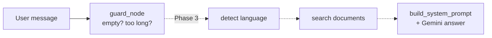

### 7.9 🏬 Module: `channels` (web, WhatsApp, voice, speech) 🟡

| Name | File | Plain explanation |
|---|---|---|
| `Channel` | `domain/message.py` | web / whatsapp / voice |
| `InboundMessage` / `OutboundMessage` | `domain/message.py` | A message coming in (with its channel and message id) / going out (max 3 buttons) |
| `ChannelSender` | `ports/channel.py` | Contract: send a message on a channel |
| `Transcript` / `SynthesizedSpeech` | `ports/speech.py` | Speech-to-text result / generated audio |
| `SpeechToText` / `TextToSpeech` | `ports/speech.py` | Contracts for speech |
| `SarvamSettings` / `SarvamSpeechToText` / `SarvamTextToSpeech` | `adapters/speech/sarvam_speech.py` | Sarvam speech: `saaras:v4` (listen), `bulbul:v4-flash` (speak; Malayalam/Odia use `bulbul:v3`) |
| `transcribe` / `synthesize` | same | Audio → text / text → audio |
| `_settings_with_key` / `create_sarvam_stt` / `create_sarvam_tts` | same | Load settings; refuse an empty key 🔒; registry factories |
| `WhatsAppSettings` / `WhatsAppSender` / `send` | `adapters/whatsapp/client.py` | Sends WhatsApp messages through Meta's API (Phase 4) |
| `is_valid_signature` | `adapters/whatsapp/signature.py` | 🔒 Proves a WhatsApp webhook really came from Meta (fails closed) |
| `sse_event` | `adapters/web/sse.py` | Formats one streaming message for the widget |

### 7.10 🏬 Modules: `handoff`, `leads`, `analytics` 🟡

| Name | File | Plain explanation |
|---|---|---|
| `HandoffRow` | `handoff/adapters/orm.py` | A chat passed to a human: requested → notified → human → closed / after_hours |
| `LeadRow` | `leads/adapters/orm.py` | Captured customer details + CRM sync status |
| `UsageLogRow` | `analytics/adapters/orm.py` | Tokens and cost per AI call, and whose key paid |

---

## 8. 🎛️ Bot Studio (dashboard) and the widget

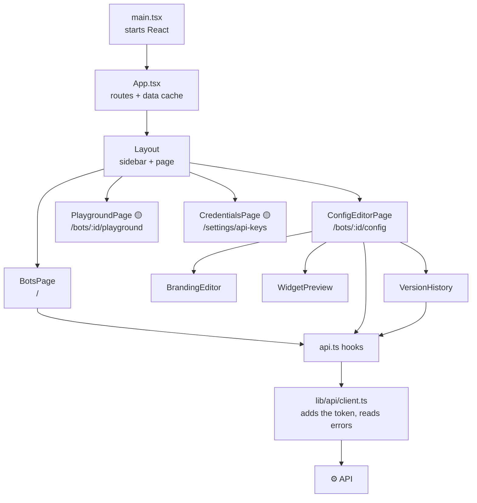

| File | Name | Plain explanation |
|---|---|---|
| `main.tsx` | — | Starts React inside the page's `#root` element |
| `app/App.tsx` | `App` | Sets up the data cache (React Query) and the pages (routes) |
| `components/Layout.tsx` | `Layout` | Sidebar (Bots, API keys) + the current page |
| `components/Field.tsx` | `Field` | One form field with label, hint and error text |
| `features/bots/BotsPage.tsx` | `BotsPage` | Lists your bots and has the "Create a bot" form |
| `features/bots/api.ts` | `useBots` / `useCreateBot` | Load bots / create a bot (then refresh the list) |
| `features/bot-config/ConfigEditorPage.tsx` | `ConfigEditorPage` | The settings editor: personality, model, style, branding, save, publish |
| `features/bot-config/api.ts` | `useDraft` / `useVersions` / `useModelOptions` / `useSaveDraft` / `usePublish` / `useRollback` | Talk to the configuration endpoints |
| `features/bot-config/schema.ts` | `botConfigSchema` / `DEFAULT_CONFIG` | Checks the form in the browser with the same limits as the backend (the backend still decides) |
| `features/bot-config/presets.ts` | `STYLE_PRESETS` | Plain-language descriptions of precise / balanced / friendly |
| `features/bot-config/VersionHistory.tsx` | `VersionHistory` | Lists versions; "Restore" an archived one |
| `features/branding/BrandingEditor.tsx` | `BrandingEditor` | Title, subtitle, greeting, footer, colour, position (logo upload in Phase 4) |
| `features/branding/WidgetPreview.tsx` | `WidgetPreview` | Live preview of the chat bubble; shows business text as **plain text only** 🔒 |
| `features/playground/PlaygroundPage.tsx` | `PlaygroundPage` | 🟡 Test chat before publishing (Phase 3) |
| `features/credentials/CredentialsPage.tsx` | `CredentialsPage` | 🟡 Businesses' own AI keys (Phase 8) |
| `lib/api/client.ts` | `api` / `ApiError` | The **only** way the dashboard calls the API: adds the login token, turns errors into `ApiError` |
| `lib/api/types.ts` | types | TypeScript shapes matching the backend responses |
| `lib/auth/token.ts` | `setAccessToken` / `getAccessToken` | Keeps the login token **in memory only** (never in localStorage) 🔒 |
| `widget/src/index.ts` | `mount` | 🟡 Placeholder chat button; the real widget arrives in Phase 4 |

---

## 9. 🗄️ Database migrations

A **migration** is a numbered, reversible script that changes the database. Never change tables by hand.

| Migration | What it does |
|---|---|
| `0001` baseline | Turns on **pgvector** (needed for meaning-based search) |
| `0002` phase 1 schema | Creates all 16 tables, row-level security on each, the widget key lookup function, and safe permissions |
| `0003` membership lookup | Adds `resolve_user_membership()` for logins + its index |

`backend/migrations/schema.sql` is the same SQL in one file (regenerate with `make schema-sql`).

---

## 10. 🧪 Tests: how we prove it works

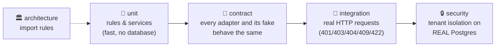

| Folder | Proves | Example |
|---|---|---|
| `tests/unit/` | Business rules and services | A bot with no language is refused; forged tokens are rejected |
| `tests/contracts/` | Each real adapter behaves like its contract (and so does its fake) | Gemini, Sarvam, Supabase, SQL repositories |
| `tests/integration/` | Endpoints return the right codes and shapes | Viewer can't delete a bot (403) |
| `tests/security/` | Tenant A can never see tenant B, on a real database | Plus the widget lookup end to end |
| `tests/architecture/` | Folder rules aren't broken | `domain/` imports no frameworks |
| `tests/fakes/` | Pretend versions of databases and vendors used by fast tests | `InMemoryBotRepository` |

Run them: `make test` (fast) and `make test-db` (real Postgres).

---

## 11. 🐳 Servers, deploys and scripts

| File | Plain explanation |
|---|---|
| `infra/docker-compose.yml` | Local development: API (hot reload), worker, Redis |
| `infra/docker-compose.prod.yml` | Production on the VPS: migrate first, then API, worker, Redis, Bot Studio; routed by the server's Traefik with HTTPS |
| `backend/Dockerfile` | Recipe for the backend image (non-root user) |
| `dashboard/Dockerfile` + `nginx.conf.template` | Builds Bot Studio and serves it with strict security headers |
| `scripts/check_keys.py` | `make check-keys`: tests every API key with one cheap call |
| `scripts/smoke_live.py` | `make smoke-live`: real login on the live server, create + publish a test bot, then delete it |
| `scripts/vps/setup.sh` | One-time server hardening (firewall, SSH keys only, Docker), checks Traefik |
| `dashboard/scripts/audit-check.mjs` | Strict security audit of dashboard packages, with reviewed, expiring exceptions |
| `.github/workflows/ci.yml` | Runs every check on each pull request |

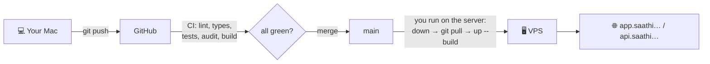

Daily commands: [`runbooks/deploy-and-daily-operations.md`](runbooks/deploy-and-daily-operations.md).

---

## 12. 🛣️ Built vs. planned, by phase

| Phase | Theme | Status |
|---|---|---|
| **0** | Accounts, keys, decisions | 🟢 Done |
| **1** | Foundation: database, security, login, bot API, CI, live deploy | 🟢 **Done** (2026-11-18) |
| **2** | Knowledge base: upload documents, chunk, embed, search | ⏳ Next |
| **3** | Chat brain: prompts, answers, streaming, playground | ⏳ |
| **4** | Channels: real widget, WhatsApp, logo upload | ⏳ |
| **5** | Studio login & screens, handoff, leads, analytics | ⏳ |
| **6** | Hardening: rate limits, privacy features, monitoring | ⏳ |
| **8** | Pro: businesses' own AI keys, voice | ⏳ |

---

## 13. 📖 Glossary

| Word | Meaning |
|---|---|
| **Tenant** | One business using Saathi |
| **Principal** | "Who is calling": user + tenant + role |
| **RLS (row-level security)** | Database rule that hides other tenants' rows |
| **Port** | A contract ("we need something that can do X") |
| **Adapter** | Real code that fulfils a port (e.g. Gemini, SQL) |
| **Registry** | A phone book of adapters, picked by name from settings |
| **Repository** | Code that saves and loads business objects |
| **Service** | Code for one user action ("create a bot") |
| **Domain object** | A business thing that checks its own rules (e.g. `Bot`) |
| **Migration** | Numbered, reversible database change |
| **Embedding** | A list of numbers capturing a text's meaning, used for search |
| **JWT / token** | The signed "ticket" a user gets after logging in |
| **JWKS** | Supabase's public keys used to check those tickets |
| **SECURITY DEFINER function** | A narrow database function allowed to look past RLS for one specific, safe question |
| **CI** | Automatic checks on every pull request |
| **Traefik** | The server's front door: HTTPS and routing to the right app |
| **Fail closed** | When unsure, refuse |

---

## 🔄 How to keep this guide up to date

At the end of **every phase** (or any PR that adds code):

1. Add new classes and functions to the right table in [section 7](#7--code-reference-every-class-and-function) (or [8](#8--bot-studio-dashboard-and-the-widget) for the dashboard).
2. Update the journeys (section 5) and diagrams if a flow changed.
3. Change 🟡 to 🟢 for anything that's now built, and update [section 12](#12--built-vs-planned-by-phase).
4. Update the **Last updated** line at the top and add a line to the log below.
5. Run the coverage check, which lists any backend class or function the guide doesn't mention yet:

```bash
make code-guide-check
```

### Update log

| Date | Phase | Change |
|---|---|---|
| 2026-11-18 | 1 complete | First version: all 142 classes and 271 functions/methods of the backend, the dashboard, flows, data, tests and deploys |
| 2026-11-22 | 2 (P2.1-P2.16) | Knowledge base and RAG core: journeys 5.8-5.11, table 17 (`unanswered_questions`), knowledge module reference, answer use case and guardrail, bridges, SSRF guard, upload checks (623 names) |
