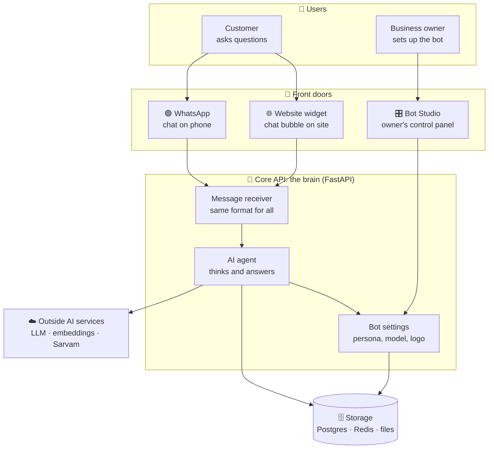
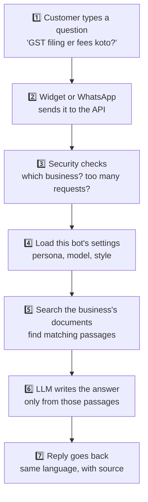
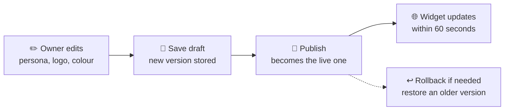
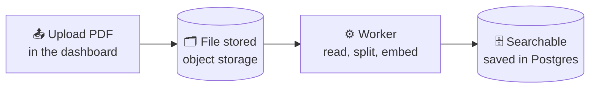
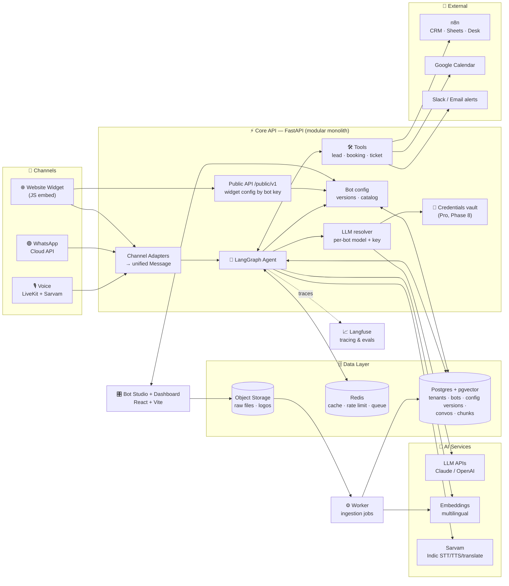
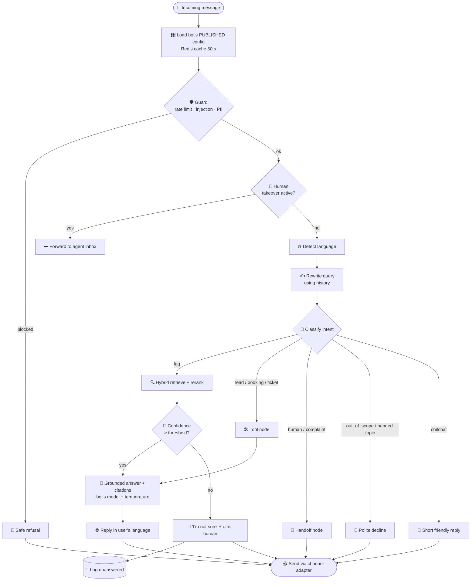
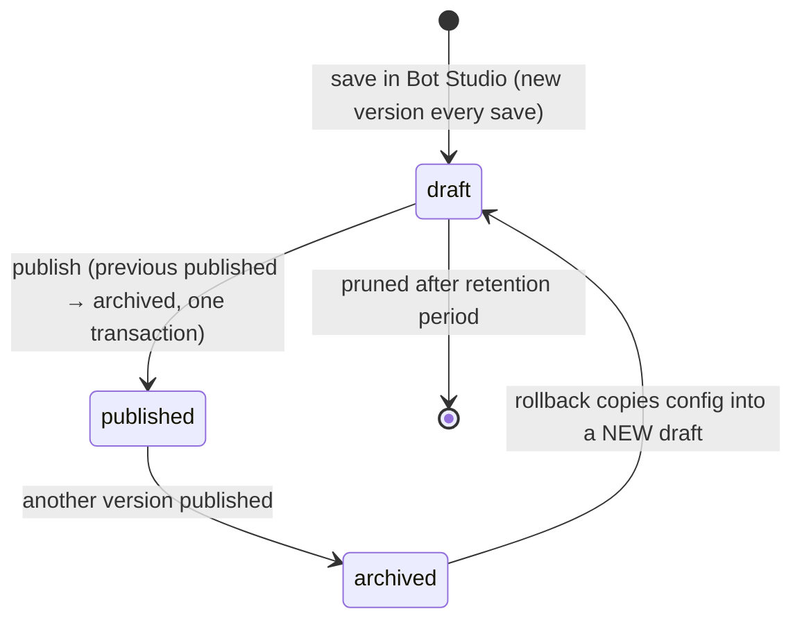
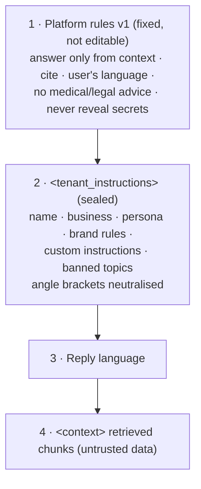
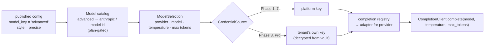
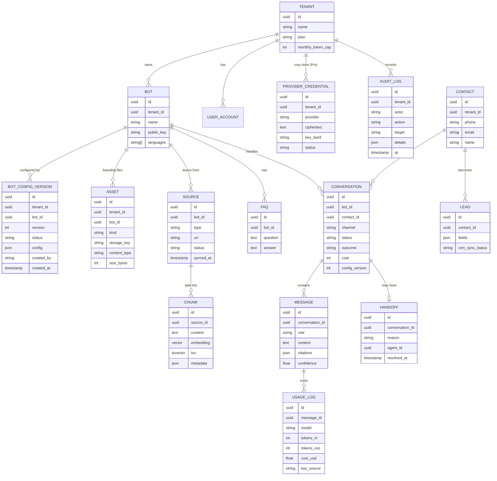

# 🏗️ Saathi AI — Architecture & Tool Stack

---

## 1. 🗺️ High-level architecture

> Start with the four simple pictures in 1.1–1.4. The detailed diagram in 1.6 shows the same system with every component; read it once the simple pictures make sense.

### 1.1 The big picture (four layers)



| Layer | What it is |
|---|---|
| **Users** | A *customer* who asks questions, and a *business owner* (the tenant) who sets up the bot |
| **Front doors** | Customers come in through the **website widget** or **WhatsApp**; owners use **Bot Studio**. They're different ways into the same system |
| **The brain** | One FastAPI program: it receives every message in the same format, keeps each bot's **settings**, and runs the **AI agent** that decides the reply |
| **What the brain relies on** | Its own **storage** (data, cache, files) and paid **outside AI services** (the LLM writes answers, embeddings power document search, Sarvam handles Hindi/Bengali speech) |

### 1.2 What happens when a customer asks a question



| Step | What happens | Box in the detailed diagram (1.6) |
|---|---|---|
| 1 | Customer types a question, e.g. in Banglish | Website Widget / WhatsApp |
| 2 | The front door forwards it to the API | Channel Adapters → unified Message |
| 3 | The API works out which business the bot belongs to and blocks spam; each business only ever sees its own data | Core API (tenant + rate limit) |
| 4 | Loads the persona, response style and model the owner chose in Bot Studio | Bot config |
| 5 | Finds the passages in that business's documents that match the question | LangGraph Agent → Postgres + pgvector |
| 6 | The bot's chosen model writes a reply using only those passages, or says "I'm not sure" if they don't contain the answer | LLM resolver → LLM APIs |
| 7 | Reply goes back in the customer's language with a source like "📄 Pricing.pdf" | Channel Adapters → channel |

Every step is also recorded in Langfuse (time taken, cost): that's the dotted "traces" arrow in 1.6.

### 1.3 How the owner changes the bot (Bot Studio)



- Every **save** stores a new version, so nothing is ever lost.
- **Publish** makes one version live; customers only ever see the published version, never a half-finished draft.
- The **widget** fetches the live logo, header, footer and colour through a public address (*1.6: "Public API /public/v1" → "Bot config"*). It receives only the bot's look, never its prompt or settings.
- If a change goes wrong, **rollback** restores an older version in one click.
- Logo files are kept in file storage (*1.6: "Bot Studio" → "Object Storage"*).

### 1.4 How documents become searchable (background)



The **worker** is a second program running alongside the API, so customers never wait for this. It reads the PDF, splits it into small passages and converts each passage into numbers (*embeddings*) so search works by meaning, even when a Bengali question meets an English document. It then saves everything in Postgres (*1.6: Object Storage → Worker → Embeddings → Postgres*).

### 1.5 The remaining boxes in plain words

| Box in the detailed diagram | What it really means |
|---|---|
| Tools (lead · booking · ticket) | Actions the bot can take: save a lead, book an appointment, create a ticket. They send data out to **n8n** (CRM, Google Sheets), **Google Calendar** and **Slack/email** |
| Credentials vault (Pro, Phase 8) | A locked, encrypted place for a business's own AI API key. Until Phase 8, every bot uses the platform key |
| Redis | Fast short-term memory: last chat turns, cached bot settings, spam limits, background job queue |
| Voice (LiveKit + Sarvam) | A future phone/voice channel (Pro); just another front door |
| Langfuse | Records every step of every conversation (time, tokens, cost, config version) for debugging and reports |

> **In one line:** customers and owners come in through three doors, one brain answers using the bot's settings and the business's documents, the brain stores data in Postgres/Redis/files, and it pays outside AI services to write the answers.

### 1.6 Detailed diagram (every component)



**Style:** one FastAPI process + one worker, organised as independent business modules (`tenancy`, `knowledge`, `conversation`, `channels`, `handoff`, `leads`, `analytics`, `credentials`) with ports and adapters inside each (see `06_REPO_STRUCTURE.md` and ADR-0001).

---

## 2. 🧰 Tool stack: what, why, alternative

### 🐍 Backend & AI

| Layer | ✅ Choice | 🤔 Why | 🔁 Alternative |
|---|---|---|---|
| Language | **Python 3.12** | Your strongest language; best AI ecosystem | — |
| API framework | **FastAPI** | Async, fast, auto OpenAPI docs, you already use it | Litestar |
| Agent orchestration | **LangGraph** | Explicit state machine: easy to add handoff/tool nodes and to debug | Plain Python state machine |
| LLM (answers) | **Per bot**, from a plan-gated **model catalog**: **Gemini** primary ("Standard" = `gemini-3.8-flash`, "Advanced" = `gemini-4-argon`); any vendor pluggable (ADR-0006) | Tenants choose quality vs cost without seeing vendor model ids | Claude (`claude-standard` / `claude-advanced`) |
| LLM (routing/rewrite) | **Gemini Flash-class / Flash-Lite-class** (platform-wide) | 5–10× cheaper for small tasks | Claude Haiku-class; Groq-hosted Llama |
| Embeddings | **Google `gemini-embedding-2`** at **1,536 dimensions** (shortened from its 3,072 default; platform-wide; ADR-0006) | Strong multilingual retrieval (Bengali question → English document); shortening keeps it inside pgvector's indexing limit at half the storage (see note below); changing per bot would force re-indexing | `gemini-embedding-001`; full 3,072 dims as `halfvec`; OpenAI `text-embedding-3-small`; BGE-M3 (self-host) |
| Reranker | **Cohere Rerank (multilingual)** | Big precision gain for a few lines of code | BGE-reranker (self-host) |
| Indic speech/translate | **Sarvam AI** (STT `saaras:v4`, TTS `bulbul:v4-flash`, `bulbul:v3` for Malayalam/Odia) behind `SpeechToText` / `TextToSpeech` ports; any vendor pluggable (ADR-0006) | Best-in-class Hindi/Bengali; your existing expertise | Gemini / Google STT/TTS |
| Doc parsing | **Docling** / **unstructured** + **PyMuPDF** | Keeps tables & headings; OCR fallback for scans | LlamaParse |
| Web crawling | **Crawl4AI** / **Firecrawl** | Clean markdown output from sites | Scrapy |
| Background jobs | **ARQ** (Redis) or **Celery** | Ingestion must not block chat | Dramatiq |
| Secret encryption | **`cryptography` AES-256-GCM** with key ids + associated data | Tenant API keys / WhatsApp tokens encrypted and bound to their owner | Cloud KMS envelope encryption |

### 🗄️ Data

| Layer | ✅ Choice | 🤔 Why | 🔁 Alternative |
|---|---|---|---|
| Database | **PostgreSQL 16 on Supabase** (ADR-0002) | One DB for relational + vector + full-text = simpler ops | — |
| Vector search | **pgvector (HNSW index)** on `vector(1536)` | Good enough up to millions of chunks; RLS gives tenant isolation; available on every managed Postgres we're considering | `halfvec(3072)` if full-size Gemini vectors win the eval; **VectorChord** (scale-up path, see note below); Qdrant; Pinecone |
| Keyword search | **Postgres `tsvector`** | Hybrid search without extra infra | OpenSearch |
| Cache / queue / limits | **Redis (Upstash)** | Session memory, semantic cache, rate limiting, published-config cache | Valkey |
| File storage | **Supabase Storage** (ADR-0002); S3 / Cloudflare R2 possible via the `ObjectStore` port | Raw uploads (private), logos (public), tenant-prefixed keys | — |

> **Why pgvector now, and when VectorChord.** VectorChord is a Postgres extension built on pgvector's `vector` type. It uses a compressed IVF index (RaBitQ) instead of HNSW and benchmarks markedly faster for queries, inserts and index builds, especially at tens of millions of vectors. Because it keeps the same `vector` column and query syntax, switching later means **swapping the index**, not rewriting the knowledge module.
>
> **Gemini embeddings (3,072 dimensions) and pgvector's limit.** pgvector *stores* vectors up to 16,000 dimensions, but its HNSW/IVFFlat *indexes* accept at most 2,000 dimensions for `vector` and 4,000 for `halfvec` (16-bit floats). So a full-size Gemini vector in a `vector(3072)` column inserts fine and then fails at `CREATE INDEX`. Three ways to handle it:
>
> | Option | How | Trade-off | Decision |
> |---|---|---|---|
> | **A. Shorten to 1,536** | Request `output_dimensionality=1536` (Gemini is trained to be shortened; Google recommends 768, 1,536 or 3,072); store `vector(1536)`, HNSW | Half the storage and RAM of 3,072; small quality loss | ✅ **Default** |
> | B. Full size as `halfvec(3072)` | Store or cast to `halfvec(3072)`, index with `halfvec_cosine_ops` | Works on Supabase/Neon; ~2× the index size of option A | Switch only if the golden eval shows a clear gain |
> | C. VectorChord | `vchordrq` index on `vector(3072)` | Handles very long vectors and huge scale, but needs self-hosted Postgres (reasons below) | Scale-up path |
>
> Whichever is chosen: fix the dimension **before** the first ingestion (changing it later means re-embedding every document), use the same model and dimension for documents and queries, and L2-normalise shortened vectors before storing them.
>
> We stay on pgvector for the MVP because:
> 1. **Hosting:** Supabase and Neon (ADR-0002) ship pgvector but not VectorChord. VectorChord must be loaded via `shared_preload_libraries`, which means self-hosted Postgres (Docker image / VPS) or VectorChord Cloud.
> 2. **Scale:** an SMB tenant has hundreds to tens of thousands of chunks. The whole platform stays well under a few million rows for a long time, where pgvector HNSW meets the p95 < 4 s target.
> 3. **Licence:** VectorChord is AGPL-3.0 (with an alternative licence offered by the vendor). Check the terms before shipping it inside a commercial hosted product.
>
> **Revisit when** any of these is true: the chunk table passes ~5–10M rows, HNSW index builds or RAM become a cost problem, retrieval p95 exceeds ~400 ms, or we move to self-hosted Postgres (Hetzner/VPS stage). Then run the golden eval and a load test with both indexes, and record the decision as a new ADR.

### 🖥️ Frontend

| Layer | ✅ Choice | 🤔 Why |
|---|---|---|
| Bot Studio + admin dashboard | **React 19 + Vite + TypeScript**, React Query, React Hook Form + Zod, React Router (shadcn/ui optional) | Static build, no server to run or secure, fast to develop (ADR-0005) |
| Chat widget | **Preact or vanilla TS, built as a single `widget.js`** | Tiny bundle (< 50 KB) so it doesn't slow client sites; branding fetched from the public config endpoint |
| Realtime | **Server-Sent Events** (streaming) + **WebSocket** for agent inbox | Streaming answers feel 2× faster |
| Auth | **Supabase Auth** (ADR-0002) | Team invites + roles out of the box |
| Charts | **Recharts** | Analytics screens |

### 🔌 Integrations & Ops

| Layer | ✅ Choice | 🤔 Why |
|---|---|---|
| WhatsApp | **Meta WhatsApp Cloud API** (direct) | No BSP markup; fall back to Twilio/Gupshup if the client already has one |
| Workflow glue | **n8n (self-hosted)** | Every CRM without custom code; clients ask for it by name |
| Observability | **Langfuse** | Traces, cost per tenant, prompt and config versions, eval datasets |
| Evaluation | **RAGAS** + custom golden set | Proves quality to clients with numbers |
| Containers | **Docker + docker-compose** | Same stack on laptop and server (closes your deployment gap) |
| Hosting | **Hostinger VPS (Mumbai)**: Docker Compose (API + worker + Redis + Bot Studio) behind the server's existing Traefik with Let's Encrypt, shared with n8n (ADR-0008) → more VPSs behind a load balancer or a managed container service (scale) | Low, predictable cost and full control; close to users |
| CI/CD | **GitHub Actions** | Lint → types → boundaries → tests → Studio build → eval → Docker build → deploy |
| Errors & uptime | **Sentry** + **Better Stack / UptimeRobot** | Know before the client calls you |

---

## 3. 🧠 LangGraph agent design



### 📦 Agent state (simplified)

```python
class ChatState(TypedDict):
    tenant_id: str
    bot_id: str
    config_version: int          # which published config answered (traced, reportable)
    conversation_id: str
    channel: Literal["web", "whatsapp", "voice"]
    user_message: str
    language: Literal["en", "hi", "bn", "hinglish", "banglish"]
    standalone_query: str
    intent: str
    retrieved_chunks: list[Chunk]
    confidence: float
    tool_result: dict | None
    answer: str
    citations: list[Citation]
    handoff: bool
```

---

## 4. 🎛️ Bot configuration & per-bot models

### 4.1 Configuration lifecycle



- Stored in `bot_config_versions` (append-only). A partial unique index allows **one published version per bot**.
- What a version holds:

| Group | Fields | Who edits |
|---|---|---|
| Prompt | persona, brand rules, banned topics (≤ 20), custom instructions (≤ 4,000 chars) | Admin (custom instructions = advanced) |
| Generation | model key (catalog), response style preset, temperature override (0–1), max output tokens (64–2,000) | Admin (override/model = advanced) |
| Branding | header title/subtitle, footer, greeting, primary colour (hex), launcher position, logo asset id | Admin |

### 4.2 Prompt layering (tenants cannot remove safety)



### 4.3 Per-bot model resolution



No key available → **fail closed** with a configuration error; never fall back to an unintended key.

### 4.4 Public widget configuration

`GET /public/v1/widgets/{public_key}/config` → header, subtitle, footer, greeting, colour, launcher position, logo URL, languages. Resolution: public key → `resolve_bot_public_key()` (SECURITY DEFINER, returns only `tenant_id, bot_id`) → read inside the tenant's RLS scope → `Cache-Control: public, max-age=60`. No prompt or generation settings are ever exposed (ADR-0003).

---

## 5. 🗃️ Data model



| Table | Key constraints / indexes | Why |
|---|---|---|
| `bots` | `UNIQUE (tenant_id, name)`, `UNIQUE (public_key)`, index `(tenant_id, created_at)` | Names per tenant; widget lookup; list a tenant's bots |
| `bot_config_versions` | `UNIQUE (bot_id, version)`, partial unique `(bot_id) WHERE status='published'`, index `(bot_id, status, version)` | Ordered history; exactly one live config; fast "latest draft" |
| `provider_credentials` | partial unique `(tenant_id, provider) WHERE status='active'` | One active key per provider |
| all tenant tables | `tenant_id NOT NULL` + RLS policy (`ENABLE` + `FORCE`) | Isolation enforced by the database |

---

## 6. 📂 Repository layout

The repository is a **modular monolith** with hexagonal modules. The full, diagram-led explanation of every folder is in **`06_REPO_STRUCTURE.md`**. Top level:

```
saathi-ai/
├── backend/        FastAPI API + ARQ worker (src/saathi/{platform,modules,api,bootstrap}), migrations, tests
├── dashboard/      🎛️ Bot Studio + admin dashboard (React + Vite + TypeScript)
├── widget/         embeddable chat widget → widget.js
├── evals/          golden datasets + runners
├── demos/          TaxMitra (CA firm), ClinicCare (clinic)
├── infra/          docker-compose (dev + prod), Postgres init (least-privilege role), deploy notes
├── n8n/            exported workflow JSONs
├── scripts/        operational helpers (API key checks)
├── docs/           ADRs 0001–0005, runbooks, structure guide
└── .github/        CI (backend, Studio, golden set, Docker, secret scan)
```

---

## 7. 💸 Running-cost model (per client, estimate)

> ⚠️ *Rough planning numbers. Check current provider pricing before quoting clients.*

| Item | Assumption | Approx. monthly |
|---|---|---|
| LLM: answers | 3,000 conversations × ~4 turns, "Standard" model | $15 – 40 ("Advanced" ≈ 3–5×) |
| LLM: routing/rewrite | Small model on every turn | $1 – 3 |
| Embeddings | Initial KB + re-syncs | < $1 |
| Reranker | Per query | $2 – 5 |
| WhatsApp | Meta per-message pricing (service replies within 24h window are cheap/free; templates cost) | Varies by country/category |
| Hosting share | Multi-tenant server split across clients; Bot Studio is static (near-zero) | $5 – 15 |
| **Total** | | **≈ $25 – 65 / client** |

**Formula to show clients:**

```
monthly_cost ≈ conversations × turns × (tokens_in × price_in + tokens_out × price_out)
             + reranks × price_per_rerank + hosting_share
```

✅ With a $120–200 Growth retainer, the margin stays healthy, and because the platform is **multi-tenant**, your 10th client costs almost nothing extra to host. Gate the "Advanced" model to Growth/Pro so a Starter client can't multiply your LLM bill. Pro clients on their own API keys pay the LLM cost directly.

---

⬅️ [Features](01_FEATURES.md) · ➡️ [Process Flows](03_PROCESS_FLOWS.md)
