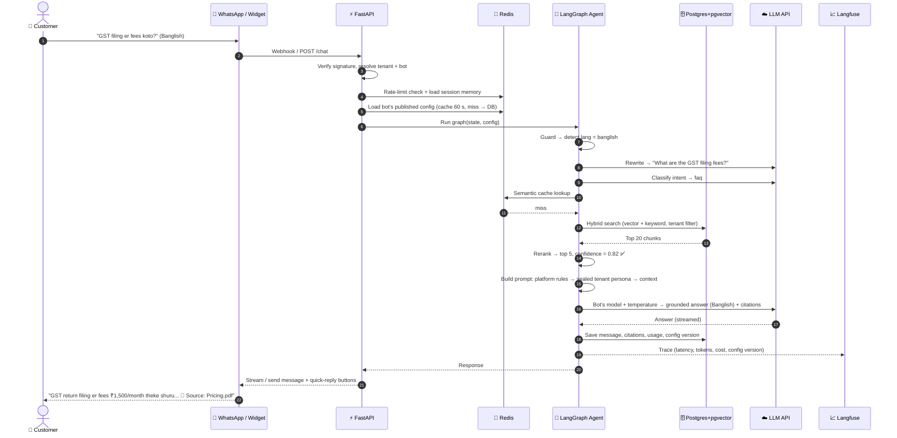
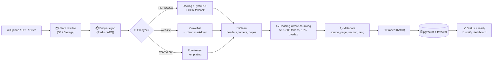
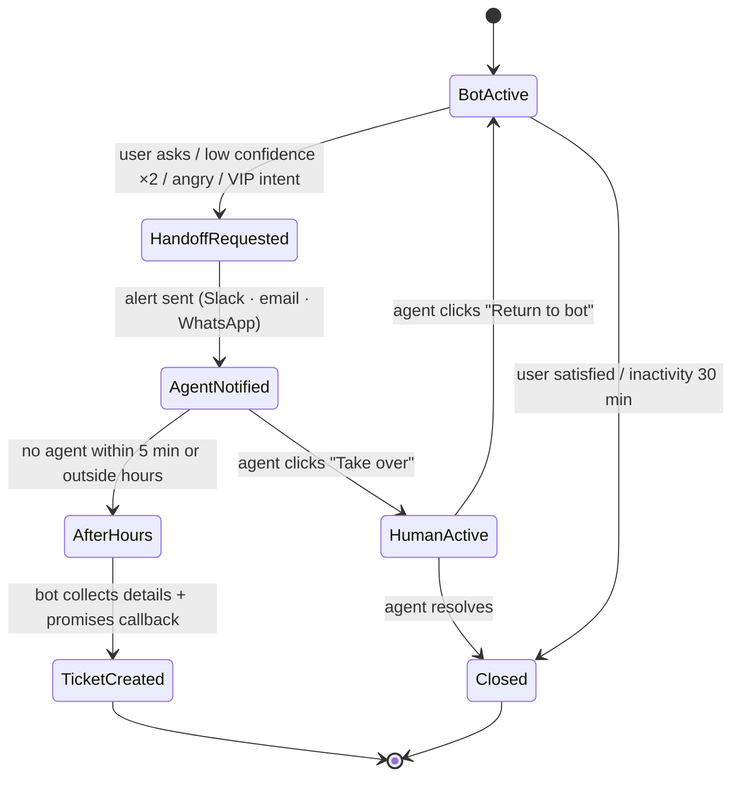
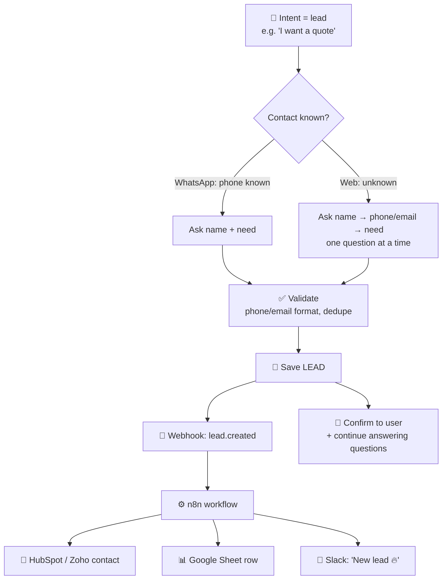
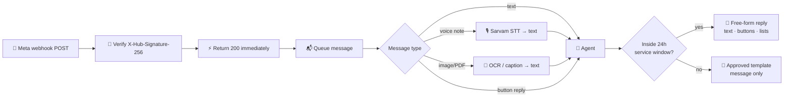
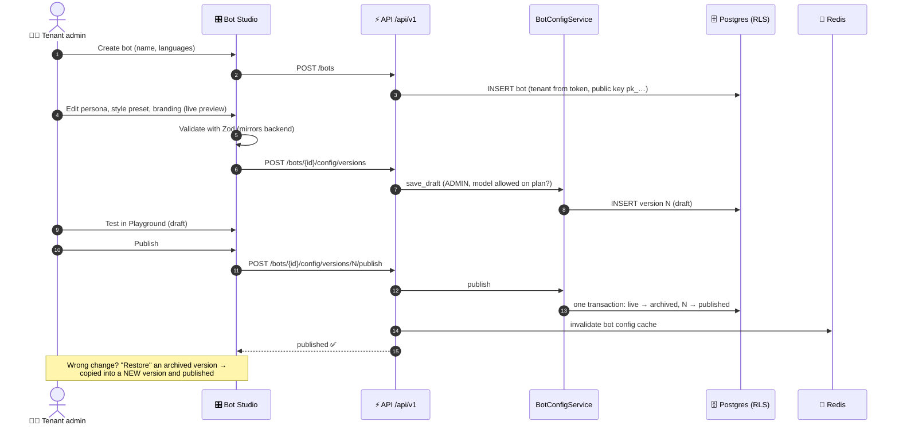
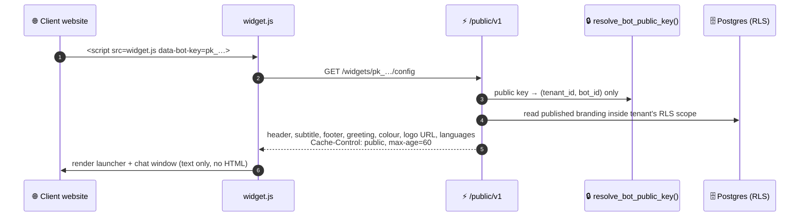
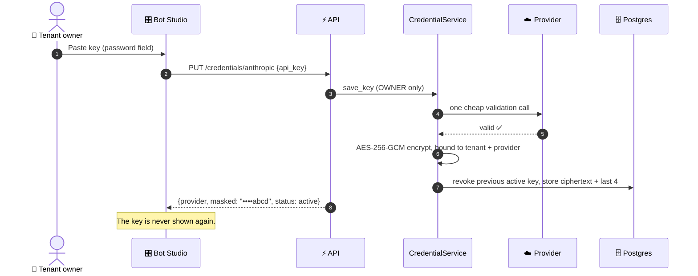
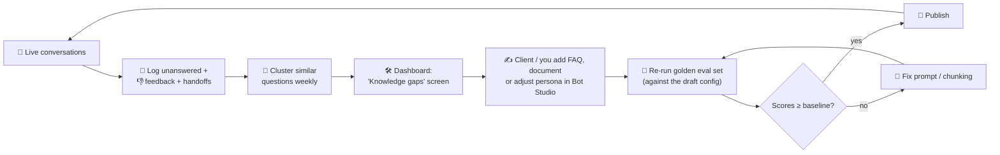
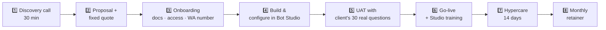

# 🔄 Saathi AI — Process Flows

| # | Flow | Type |
|---|---|---|
| 1 | [📨 Message lifecycle](#1--message-lifecycle-end-to-end) | Runtime |
| 2 | [📥 Knowledge ingestion](#2--knowledge-ingestion-pipeline) | Runtime |
| 3 | [🙋 Human handoff](#3--human-handoff-state-machine) | Runtime |
| 4 | [🎯 Lead capture](#4--lead-capture-flow) | Runtime |
| 5 | [🟢 WhatsApp rules](#5--whatsapp-specific-flow--rules) | Runtime |
| 6 | [🎛️ Bot Studio: create, configure, publish](#6-️-bot-studio-create-configure-publish) | Self-serve |
| 7 | [🎨 Widget loads its branding](#7--widget-loads-its-branding) | Runtime |
| 8 | [🔑 Tenant connects its own API key (Pro)](#8--tenant-connects-its-own-api-key-pro-phase-8) | Self-serve |
| 9 | [🔁 Continuous improvement loop](#9--continuous-improvement-loop) | Ops |
| 10 | [🤝 Client delivery process](#10--client-delivery-process-freelance) | Business |

---

## 1. 📨 Message lifecycle (end-to-end)

**⏱️ Latency budget (p95 target < 4 s):**

| Step | Budget |
|---|---|
| Webhook + tenant + Redis + cached bot config | 100 ms |
| Rewrite + intent (small model, in parallel) | 600 ms |
| Hybrid retrieval + rerank | 400 ms |
| Answer generation (first token) | 1,200 ms (bot's model; "Advanced" models may be slower) |
| Send to channel | 300 ms |

> The bot config must come from cache on the hot path. Publishing invalidates the cache key, so a change is live within seconds, at most 60 s.

---

## 2. 📥 Knowledge ingestion pipeline

**🔁 Re-sync logic:** hash each file → if the hash is unchanged, skip; if changed, delete old chunks for that source and re-ingest. Runs nightly for Drive/Notion/website sources.

---

## 3. 🙋 Human handoff state machine

**Messages the user sees:**

| State | Example message |
|---|---|
| HandoffRequested | "I'm connecting you with our team 🙋. They usually reply within a few minutes." |
| AfterHours | "Our team is offline right now (10am–7pm). I've noted your query and someone will call you tomorrow." |
| HumanActive | *(agent's messages appear with their name)* |

**🧾 What the agent receives:** AI summary (issue, language, sentiment, what the bot already tried) + full transcript + contact details.

---

## 4. 🎯 Lead capture flow

> 💡 **Conversational, not a form.** Ask one field at a time, allow the user to skip, and keep answering their questions mid-flow. This converts much better than a pop-up form.

---

## 5. 🟢 WhatsApp-specific flow & rules

| ⚠️ Rule | Why it matters |
|---|---|
| Acknowledge webhooks fast (process async) | Meta retries slow webhooks → duplicate replies |
| De-duplicate by `message.id` | Retries happen even when you're fast |
| 24-hour customer service window | Outside it you can only send pre-approved **template** messages |
| Max 3 reply buttons / 10 list rows | Design quick replies within these limits |
| Business verification + display name approval | Start this **on day 1** of a client project, as it can take days |
| Opt-in for proactive messages | Required by Meta policy; also good DPDP practice |

---

## 6. 🎛️ Bot Studio: create, configure, publish

**Who:** the tenant's Owner or Admin, in the React Bot Studio (`dashboard/`).

| Rule | Why |
|---|---|
| Every save creates a new immutable version | Full history, nothing lost, auditable |
| Publish is one transaction + a partial unique index | Never zero or two live configs |
| Rollback creates a new version (doesn't rewrite history) | The audit trail stays true |
| Model choice validated against the tenant's plan | A Starter tenant can't enable an expensive model |
| Advanced settings and publish need ADMIN | Agents and viewers can't change live behaviour |
| Tenant text sits below fixed platform rules | Persona changes can't disable grounding or safety |

---

## 7. 🎨 Widget loads its branding

- Only public fields leave the server; prompt, model and settings never do.
- Unknown or malformed key → 404. The endpoint is rate-limited per IP and per bot.
- The bot's CORS allowlist (Phase 4) decides which sites may embed it.

---

## 8. 🔑 Tenant connects its own API key (Pro, Phase 8)

**At chat time:** model resolution asks the credential source for a key → tenant key (decrypted in memory) → platform key only if the plan allows fallback → otherwise fail closed with a clear error in the Studio.

---

## 9. 🔁 Continuous improvement loop

> 💰 This loop **is** your monthly retainer. You show up each month with "we closed 23 knowledge gaps, resolution rate went from 68% → 79%". Because each conversation records its config version, you can show exactly which change moved the numbers.

---

## 10. 🤝 Client delivery process (freelance)

| Phase | Duration | Your deliverables | Client provides |
|---|---|---|---|
| 1️⃣ **Discovery** | Day 0 | Ask: top 20 customer questions, channels, languages, CRM, handoff team, volume | Time + current FAQ/support inbox examples |
| 2️⃣ **Proposal** | Day 1 | Scope, tier, timeline, price, success metrics (resolution %, response time) | Approval + 50% advance |
| 3️⃣ **Onboarding** | Days 2–3 | Checklist + secure upload link; tenant + Studio login created | Docs, website URL, WhatsApp Business account, Meta Business verification, CRM access |
| 4️⃣ **Build** | Days 3–8 | KB ingestion, persona + branding in Bot Studio (with the client), tools, widget/WhatsApp connection | Brand colours, logo, persona preferences |
| 5️⃣ **UAT** | Days 8–10 | Eval report (accuracy %, sample answers), fixes | 30 real test questions + feedback |
| 6️⃣ **Go-live** | Day 10 | Publish config, 30-min Studio + dashboard training video (Loom), handoff SOP | Agent team availability |
| 7️⃣ **Hypercare** | Days 10–24 | Daily log review, quick fixes, gap filling | Feedback |
| 8️⃣ **Retainer** | Monthly | Hosting, monitoring, KB updates, monthly KPI report | Retainer payment |

**📋 Discovery questionnaire (copy into your proposal template):**

- [ ] What are the 20 questions customers ask most often?
- [ ] Which channels do customers use: website, WhatsApp, both?
- [ ] Which languages do customers write in?
- [ ] Who handles escalations, and during what hours?
- [ ] Which CRM / sheet should leads go into?
- [ ] Any actions needed: bookings, order status, ticket creation?
- [ ] Topics the bot must **never** answer (legal advice, pricing exceptions…)?
- [ ] Who on your team will edit the bot in Bot Studio (owner/admin)?
- [ ] Do you have your own AI provider account you want to use (Pro), or should we include usage in the plan?
- [ ] Expected monthly conversation volume?
- [ ] How will we measure success after 30 days?

---

⬅️ [Architecture & Stack](02_ARCHITECTURE_AND_STACK.md) · ➡️ [Build Plan](04_BUILD_PLAN.md)
