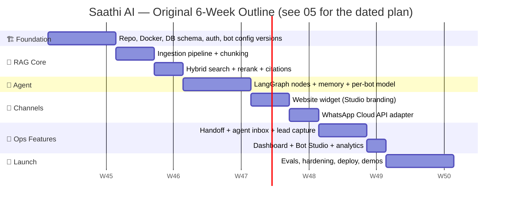

# 🚀 Saathi AI — Build Plan, Evaluation & Go-to-Market

> 🕒 **Assumes ~12–15 hours/week** alongside your full-time role (weekday evenings + weekends).
> 🎯 **Goal:** a production-grade MVP + self-serve Bot Studio + 2 live demo bots + Fiverr/Upwork listings.
>
> 📅 **Dates:** this file is the original 6-week outline. The estimated, dated plan, including Bot Studio, is **[`05_PHASEWISE_DEVELOPMENT_PLAN.md`](05_PHASEWISE_DEVELOPMENT_PLAN.md)** (MVP live **31 Jan 2027**). Where the two differ, 05 wins.

---

## 1. 📅 Timeline overview (original outline)



---

## 2. 🗓️ Week-by-week plan

### 🏗️ Week 1 — Foundation

**Goal:** a skeleton that runs locally and deploys.

- [ ] Create monorepo (`backend/`, `dashboard/`, `widget/`, `infra/`, `evals/`, `demos/`, `n8n/`)
- [ ] `docker-compose.yml`: FastAPI + Postgres (pgvector) + Redis + n8n
- [ ] SQLAlchemy models + Alembic migrations for the full data model, incl. `bot_config_versions`
- [ ] Row-Level Security policies by `tenant_id`; least-privilege app role
- [ ] Supabase/Clerk auth; tenant + bot creation API (bot public key)
- [ ] Typed, versioned bot config API: save draft → publish → rollback; model catalog
- [ ] GitHub Actions: lint (ruff) + types (mypy) + boundaries + tests (pytest) + Docker build
- [ ] Deploy a "hello world" to Railway/Render ✅ *(closes your deployment gap early)*

**🏁 Done when:** `POST /bots` works on a public URL.

---

### 🧠 Week 2 — RAG core

**Goal:** upload a PDF, ask a question, get a cited answer via API.

- [ ] Upload endpoint → object storage → ARQ job
- [ ] Parsers: Docling/PyMuPDF (+ OCR fallback), Crawl4AI, CSV
- [ ] Heading-aware chunker with metadata
- [ ] Batch embeddings → pgvector (HNSW) + `tsvector`
- [ ] Hybrid search with Reciprocal Rank Fusion
- [ ] Reranker + confidence score
- [ ] Grounded answer prompt with citations + "I don't know" rule
- [ ] FAQ override table (exact answers always win)
- [ ] 🧪 Build first **golden set: 50 Q&A** from a demo CA-firm document set

**🏁 Done when:** ≥ 80% of golden questions answered correctly with the right source.

---

### 🤖 Week 3 — Agent brain

**Goal:** a real conversational agent with state.

- [ ] LangGraph graph: guard → language → rewrite → intent → retrieve/tools/handoff → answer
- [ ] Session memory in Redis (last 6 turns + rolling summary)
- [ ] Language detection + reply in the same language/script (EN/HI/BN/Hinglish/Banglish)
- [ ] Intent classifier with small model (structured output)
- [ ] Prompt builder: fixed platform rules → sealed tenant persona/instructions → context
- [ ] Per-bot model resolution (catalog key → provider/model → key → client)
- [ ] Out-of-scope + prompt-injection handling (incl. via tenant instructions)
- [ ] Langfuse tracing on every node + cost logging + config version
- [ ] Add 20 Hindi/Bengali questions to the golden set

**🏁 Done when:** a multi-turn chat in Banglish resolves follow-ups correctly in the test script.

---

### 💬 Week 4 — Channels

**Goal:** customers can talk to it for real.

- [ ] Widget: launcher, chat window, streaming via SSE, quick-reply chips, 👍/👎, mobile layout
- [ ] Widget branding from Bot Studio via `GET /public/v1/widgets/{key}/config` (logo, header, footer, colours, greeting) → single `<script>` embed
- [ ] Logo upload with content checks (PNG/JPEG/WebP, ≤ 512 KB, no SVG)
- [ ] WhatsApp adapter: webhook verify, signature check, async queue, dedupe by message ID
- [ ] WhatsApp message types: text, buttons, lists, voice notes (Sarvam STT), documents
- [ ] 24-hour window check + template message sender
- [ ] Unified `Message` model across channels

**🏁 Done when:** the same bot answers identically on a test website and a test WhatsApp number.

---

### 🙋 Week 5 — Handoff, leads, dashboard, Bot Studio

**Goal:** this is what makes it "not a toy chatbot".

- [ ] Handoff triggers + state machine
- [ ] Agent inbox (WebSocket): take over, reply, return to bot, AI summary
- [ ] Alerts: email + Slack
- [ ] Conversational lead capture + validation + dedupe
- [ ] `lead.created` webhook → n8n workflows (HubSpot, Google Sheets, Slack): export JSON to repo
- [ ] Dashboard (React + Vite): Home KPIs, Knowledge manager + test playground, Conversations, Unanswered questions
- [ ] **Bot Studio:** persona, presets, advanced settings, branding + live preview, draft/publish/rollback, version history, playground
- [ ] Analytics queries: resolution, handoff, unanswered, CSAT, cost per conversation

**🏁 Done when:** a full journey (configure bot in Studio → question → lead → handoff → agent reply) works and appears on the dashboard.

---

### 🚀 Week 6 — Harden, evaluate, launch

**Goal:** sellable.

- [ ] Run full eval (RAGAS + golden set) → fix weak spots
- [ ] Load test: 50 concurrent chats (Locust) → p95 < 4 s
- [ ] Security pass: PII redaction in logs, rate limits, secrets, CORS, RLS test, tenant-instruction injection, branding XSS, role/plan gating
- [ ] Semantic cache + model fallback
- [ ] Sentry + uptime monitoring
- [ ] Build **2 demo bots** (see §5) on public URLs, configured through Bot Studio
- [ ] Record a 2-minute Loom demo per bot (include changing the persona live in Studio)
- [ ] Publish Fiverr gig update + Upwork project catalogue listing + portfolio case study

**🏁 Done when:** both demo links are live and the listings are published.

---

## 3. 🧪 Evaluation plan

| Metric | Tool | ✅ Ship threshold |
|---|---|---|
| **Answer correctness** (golden set, 70 Qs incl. HI/BN) | Manual + LLM judge | ≥ 85% |
| **Faithfulness** (no hallucination beyond sources) | RAGAS | ≥ 0.90 |
| **Context recall@5** | RAGAS | ≥ 0.85 |
| **Correct "I don't know"** (20 unanswerable Qs) | Custom script | ≥ 90% refuse correctly |
| **Language match** (reply in user's language) | Custom check | ≥ 95% |
| **Intent accuracy** | Labelled set of 100 messages | ≥ 90% |
| **Injection resistance** (20 user attack prompts + 20 malicious tenant instructions) | Custom red-team set | 100% blocked |
| **Latency p95** | Locust + Langfuse | < 4 s |

> 🔁 Run the eval suite **in CI** on every prompt or retrieval change, and before publishing a major config change for a client (draft config, golden set, compare with the live version). Show these numbers to clients in the UAT report; it is the clearest way to stand apart from cheap gigs.

---

## 4. ✅ Go-live checklist (per client)

**Before launch**
- [ ] Meta Business verification + WhatsApp display name approved
- [ ] All client docs ingested, status = ready
- [ ] FAQ overrides for the top 20 questions
- [ ] Persona, banned topics and branding configured in Bot Studio; config **published**
- [ ] Widget embedded with the bot's public key; CORS allowlist set to the client's domains
- [ ] Client owner/admin accounts created and trained on Bot Studio (save draft → test → publish → rollback)
- [ ] Handoff team trained, alerts tested
- [ ] CRM sync tested with a real test lead
- [ ] UAT signed off (30 client questions ≥ 85% correct)
- [ ] Privacy notice in widget + WhatsApp greeting
- [ ] Usage cap + 80% alert set; model on the right plan

**After launch**
- [ ] Daily log review for 14 days
- [ ] Week-1 report: volume, resolution, gaps closed
- [ ] Convert to monthly retainer

---

## 5. 🎬 Demo bots to build (your portfolio)

| Demo | Why | Showcases |
|---|---|---|
| 🧾 **"TaxMitra": CA firm assistant** | Matches your Kolkata CA-firm outreach | GST/ITR FAQ in Bengali/Hindi, document checklist, consultation booking, lead → Sheets, Studio branding |
| 🏥 **"ClinicCare": clinic receptionist** | Clinics are high-volume WhatsApp users | Timings, doctor availability, appointment booking, after-hours handoff, declining medical advice |
| 🛍️ *(optional)* **D2C store bot** | Most common Upwork/Fiverr buyer | Order status tool, return policy, product Q&A |

> 🎥 Each demo = live link + 2-min Loom + 1-page case study with eval numbers.

---

## 6. ⚠️ Risks & mitigations

| Risk | Impact | Mitigation |
|---|---|---|
| 🤥 Bot hallucinates prices/policies | 🔴 High | FAQ overrides, confidence threshold, citations, faithfulness eval in CI |
| 🧱 Tenant persona/instructions weaken safety | 🔴 High | Fixed platform rules first, sealed tenant section, injection test set, preset-first UI |
| 🔓 Data leakage between clients | 🔴 High | RLS + tenant filter in every query + automated isolation test; public endpoint returns public fields only |
| 🔑 Tenant API key leaked (Pro) | 🔴 High | AES-256-GCM bound to tenant + provider, write-only API, owner-only, never logged |
| 🎨 XSS via branding text or logo | 🟠 Medium | Text-only rendering, `<`/`>` rejected, logo content sniffing, no SVG |
| 🟢 WhatsApp verification delays | 🟠 Medium | Start on day 1 of onboarding; demo on widget meanwhile |
| 💸 LLM cost spike from abuse or expensive model choice | 🟠 Medium | Rate limits, per-tenant caps, plan-gated model catalog, out-of-scope refusal, cache |
| 🌐 Poor Bengali/Hindi quality | 🟠 Medium | Multilingual embeddings, Sarvam for translation, dedicated golden set |
| 🛠️ Bot Studio scope creep | 🟠 Medium | Ship presets + branding + publish first; advanced panel and playground next; BYOK in Phase 8 |
| ⏳ Scope creep from clients | 🟠 Medium | Tiered packages, written scope, change-request pricing |
| 🧑‍💻 Limited build time (full-time job) | 🟠 Medium | Strict MoSCoW; ship MUST items first; reuse your existing RAG/LangGraph code |

---

## 7. 📣 Go-to-market

| Channel | Action |
|---|---|
| 🟩 **Fiverr** (`sahil_the_aieng`) | Gig title idea: *"I will build a WhatsApp and website AI support chatbot trained on your documents, in English, Hindi or Bengali"* with 3 packages = Starter/Growth/Pro |
| 🟦 **Upwork** | Project Catalog listing + proposals to "RAG chatbot", "WhatsApp AI bot", "n8n chatbot" jobs; attach the eval report screenshot |
| 💼 **LinkedIn** | Tuesday/Friday posts: build-in-public series ("Week 2: how I stopped my chatbot from hallucinating prices", "How clients edit their own bot without breaking it") |
| 🏢 **Direct outreach** | CA firms, clinics and coaching institutes in Kolkata: send them a **demo built on their own website** (15 min of work with your crawler + Bot Studio branding) |
| 🔁 **Upsell path** | Chatbot → Bot Studio advanced → Voice agent (Pro) → own API keys → Document extraction → Workflow automation |

---

## 8. 🏁 Definition of "MVP done"

```
✅ Upload docs / crawl site → cited answers
✅ Website widget + WhatsApp live
✅ English · Hindi · Bengali (+ Hinglish/Banglish)
✅ Bot Studio: persona, presets, branding, draft → publish → rollback
✅ Handoff with agent inbox
✅ Lead capture → CRM via n8n
✅ Dashboard with KPIs + unanswered questions
✅ Multi-tenant, rate-limited, PII-safe; tenant prompts can't override safety
✅ Eval suite passing in CI
✅ Deployed with Docker + monitoring
✅ 2 public demo bots + listings published
```

---

⬅️ [Process Flows](03_PROCESS_FLOWS.md) · ➡️ [Phase-wise plan](05_PHASEWISE_DEVELOPMENT_PLAN.md) · 🏠 [Back to README](00_README.md)
