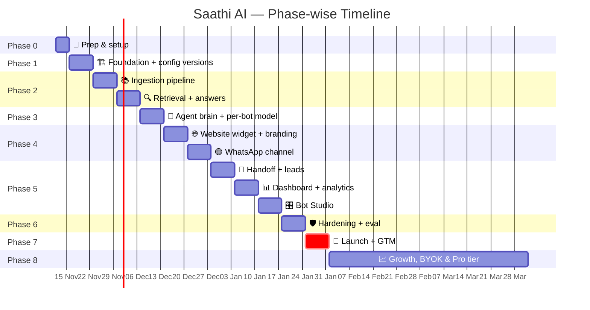
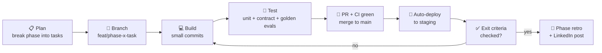
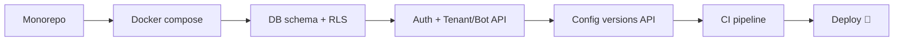
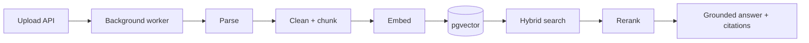
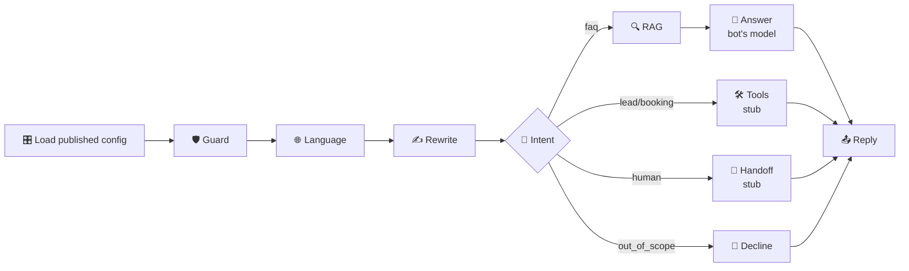
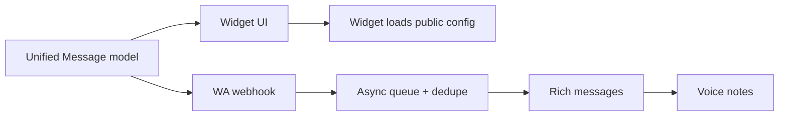
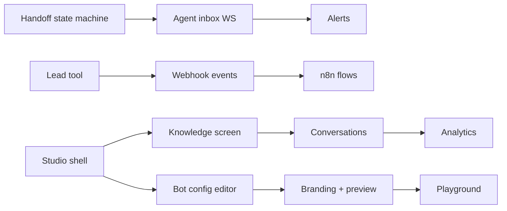
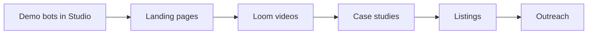
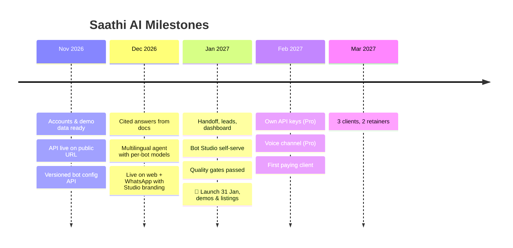

<div align="center">

# 🗺️ Saathi AI — Phase-wise Development Plan

### *From empty repo → live, sellable multilingual support chatbot with a self-serve Bot Studio*


</div>

---

## 📌 Planning assumptions

| | |
|---|---|
| 👤 **Builder** | Sahil, solo, alongside a full-time role |
| ⏰ **Capacity** | ~12–15 hrs/week → 2 hrs on 3 weekday evenings + 6–8 hrs on weekends |
| 📅 **Start** | Thu 12 Nov 2026 |
| 🎯 **MVP live + selling** | Sun 31 Jan 2027 |
| 🎄 **Buffer** | Christmas / New Year week has a lighter load built in |
| 🧭 **Priority rule** | 🔴 Must → 🟠 Should → 🟢 Could (MoSCoW). Never start a 🟢 while a 🔴 is open |
| 🔄 **Change log** | **12 Nov 2026:** Bot Studio added (self-serve bot builder: prompt, presets, model, temperature, branding, draft/publish/rollback). +≈14 h before launch, so **launch moves 24 → 31 Jan**. Tenants' own API keys (BYOK, Pro) designed now, built in Phase 8.1 (+≈7 h). |

> ℹ️ **Want to keep 24 Jan instead?** Move P5.6 (booking), P5.13 (gap clustering), P5.17 (playground) and P4.13 (logo upload; header/colours still work) to Phase 8. That removes ≈ 8 h; finish the remaining ≈ 6 h by trimming P5.15 analytics to one page.

---

## 🧭 Roadmap at a glance

```
 PHASE 0     PHASE 1      PHASE 2        PHASE 3     PHASE 4        PHASE 5           PHASE 6     PHASE 7     PHASE 8
 ┌──────┐   ┌────────┐   ┌──────────┐   ┌───────┐   ┌──────────┐   ┌─────────────┐   ┌───────┐   ┌───────┐   ┌──────────┐
 │ 🧰   │──▶│ 🏗️     │──▶│ 📚       │──▶│ 🧠    │──▶│ 💬       │──▶│ 🙋📊🎛️      │──▶│ 🛡️    │──▶│ 🚀    │──▶│ 📈       │
 │ Prep │   │ Found- │   │ Knowledge│   │ Agent │   │ Channels │   │ Handoff,    │   │ Harden│   │ Launch│   │ Grow,BYOK│
 │      │   │ ation  │   │ & RAG    │   │ Brain │   │ Web + WA │   │ Leads,      │   │ & Eval│   │ & GTM │   │ & Pro    │
 │      │   │ +config│   │          │   │ +per- │   │ +Studio  │   │ Dashboard,  │   │       │   │       │   │          │
 │      │   │ vers.  │   │          │   │ bot   │   │ branding │   │ Bot Studio  │   │       │   │       │   │          │
 └──────┘   └────────┘   └──────────┘   └───────┘   └──────────┘   └─────────────┘   └───────┘   └───────┘   └──────────┘
  4 days      1 wk          2 wks         1 wk         2 wks           3 wks             1 wk        1 wk       ongoing
```

| Phase | Name | 📅 Dates | ⏱️ Effort | 🏁 Milestone |
|:---:|---|---|:---:|---|
| **0** | 🧰 Preparation & Setup | 12 – 15 Nov | 8.5 h | Accounts, keys, demo data, decisions ready |
| **1** | 🏗️ Foundation | 16 – 22 Nov | 17 h | API deployed; bots + versioned config API live |
| **2** | 📚 Knowledge Base & RAG | 23 Nov – 6 Dec | 28 h | Cited answers from uploaded docs |
| **3** | 🧠 Agent Brain | 7 – 13 Dec | 17.5 h | Multi-turn multilingual agent, per-bot model + sealed tenant prompt |
| **4** | 💬 Channels | 14 – 27 Dec | 24.5 h | Same bot live on web + WhatsApp; widget branding from Studio |
| **5** | 🙋 Handoff, Leads, Dashboard & 🎛️ Bot Studio | 28 Dec – 17 Jan | 35.5 h | Full customer journey + self-serve bot configuration |
| **6** | 🛡️ Hardening & Evaluation | 18 – 24 Jan | 16 h | Eval suite green, Studio security tests, production deploy |
| **7** | 🚀 Launch & Go-to-Market | 25 – 31 Jan | 14 h | Demos live, gigs published |
| **8** | 📈 Post-launch Growth (BYOK → Pro) | Feb – Mar 2027 | 10–12 h/wk | Own API keys (Pro), first paying clients, Pro features |
| | | | **≈ 173 h** | |

---

## 📅 Master timeline



---

## 🔁 How every phase runs (process)



**🗓️ Weekly rhythm**

| Day | Slot | Focus |
|---|---|---|
| Mon | — | Rest / plan the week (15 min) |
| Tue | 2 h | Build |
| Wed | 2 h | Build |
| Thu | 2 h | Tests + bug fixes |
| Sat | 4 h | Deep work: hardest task of the week |
| Sun | 3 h | Finish, deploy, retro, LinkedIn draft |

**✅ Definition of Done (every task):** code merged · tests pass (incl. architecture boundaries) · deployed to staging · documented in README/ADR · traced in Langfuse (if AI-related).

---
---

## 🧰 PHASE 0 — Preparation & Setup

| 📅 Dates | ⏱️ Effort | 🎯 Goal | 🔗 Depends on |
|---|---|---|---|
| Thu 12 – Sun 15 Nov 2026 | **8.5 h** | Remove every blocker before coding starts | — |

### ✨ Outcomes
- All accounts and API keys ready
- Demo business content collected
- First golden question set drafted
- Architecture decisions recorded

### 🔄 Steps
`Create accounts` → `Collect demo data` → `Write golden questions` → `Set up local tools` → `Decide ADRs`

### 📋 Tasks

| ID | Task | Details | ⏱️ | 📦 Output |
|---|---|---|:---:|---|
| P0.1 | 🔑 Create accounts | GitHub repo, Supabase (or Neon), Upstash Redis, Railway/Render, Langfuse, Sentry | 1.5 | Accounts live |
| P0.2 | 🤖 Get API keys | Gemini (LLM + embeddings), Sarvam (speech), Cohere (rerank), Supabase; set spend caps (ADR-0006) | 0.5 | `.env` from `.env.example` |
| P0.3 | 🟢 Start Meta setup | Meta Business account + WhatsApp Cloud API **test number** (verification takes time, so start now) | 1 | Test WA number |
| P0.4 | 🧾 Collect demo data: CA firm | 10–15 docs: GST/ITR services, fees, document checklists, FAQs (write realistic sample content) | 2 | `demos/taxmitra/docs/` |
| P0.5 | 🏥 Collect demo data: clinic | Timings, doctors, services, policies | 1 | `demos/cliniccare/docs/` |
| P0.6 | ❓ Draft golden set v0 | 30 Q&A pairs (EN) with expected source document + 5–8 unanswerable | 1.5 | `evals/golden/golden_v0.jsonl` |
| P0.7 | 🛠️ Local tooling | Docker Desktop, uv, Node 20, VS Code / Claude Code, pre-commit | 0.5 | Working dev machine |
| P0.8 | 📝 Decide ADRs | Accept/reject 0001 (layout), 0003 (bot config), 0005 (React + Vite Studio); decide 0002 (DB/hosting/auth) | 0.5 | ADR statuses updated |

### 🏁 Exit criteria
- [ ] All keys work (`make check-keys`)
- [ ] WhatsApp test number delivers the `hello_world` template (`make check-keys ARGS=--send-whatsapp`)
- [ ] Demo docs + golden questions committed (`make validate-golden`)
- [ ] ADR-0002 decided

---

## 🏗️ PHASE 1 — Foundation

| 📅 Dates | ⏱️ Effort | 🎯 Goal | 🔗 Depends on |
|---|---|---|---|
| Mon 16 – Sun 22 Nov 2026 | **17 h** | A clean, deployable skeleton with multi-tenant data model and versioned bot configuration | Phase 0 |

### ✨ Features delivered
- 🏢 Tenant + bot management API (bots get a public widget key)
- 🎛️ Versioned bot configuration API: save draft → publish → rollback, model catalog
- 🔐 Auth with roles (Owner / Admin / Agent / Viewer)
- 🗄️ Full database schema with tenant isolation (RLS)
- 🐳 Dockerised stack + CI/CD + first cloud deploy

### 🔄 Steps


### 📋 Tasks

| ID | Task | Details | ⏱️ | 📦 Output |
|---|---|---|:---:|---|
| P1.1 | 📁 Monorepo scaffold | `backend/ dashboard/ widget/ infra/ evals/ demos/ n8n/` + README (scaffold already provided) | 1 | Repo structure |
| P1.2 | 🐳 Docker compose | FastAPI, Postgres 16 + pgvector, Redis, n8n; hot-reload for dev | 2 | `infra/docker-compose.yml` |
| P1.3 | ⚡ FastAPI skeleton | App factory, settings, `/health`, `/ready`, structured logging, error handler | 1.5 | Running API |
| P1.4 | 🗄️ Data model | tenant, bot (+ public_key), **bot_config_versions**, source, chunk, faq, contact, conversation, message, handoff, lead, usage_log | 3 | `modules/*/adapters/orm.py` |
| P1.5 | 🔄 Migrations | Alembic initial migration + pgvector extension | 1 | `backend/migrations/` |
| P1.6 | 🔐 Row-Level Security | RLS (`ENABLE` + `FORCE`) on all tenant tables + transaction-scoped `tenant_id`; isolation test; SQL repositories added to contract suites | 1.5 | SQL policies + tests |
| P1.7 | 👤 Auth | Supabase Auth / Clerk JWT verification (JWKS), role checks | 2 | `TokenVerifier` adapter |
| P1.8 | 🏢 Tenant & Bot API + config versions | CRUD `/bots`; `/bots/{id}/config/versions` (save draft), `/publish`, `/rollback`, `/draft`, `/published`; `/model-options` (plan-gated catalog) | 3 | REST endpoints |
| P1.9 | ✅ CI pipeline | GitHub Actions: ruff, mypy, import-linter, pytest, Studio build, Docker build, gitleaks | 1 | `.github/workflows/ci.yml` |
| P1.10 | 🚀 First deploy | Railway/Render from `main`, managed Postgres + Redis, env secrets | 0.5 | Public URL |
| P1.11 | 🔑 Public widget lookup | `resolve_bot_public_key()` SECURITY DEFINER function + `/public/v1/widgets/{key}/config` | 0.5 | Public endpoint |

### 🏁 Exit criteria
- [ ] `POST /bots` and `POST /bots/{id}/config/versions` work on the **public URL** with a valid token
- [ ] Automated test proves tenant A **cannot** read tenant B's bots or config versions
- [ ] Publishing twice leaves exactly one published version (DB constraint verified)
- [ ] CI is green on `main`

> 💡 *Phase 1 also covers the Docker + CI/CD + cloud deployment skills you've flagged as your biggest gap.*

---

## 📚 PHASE 2 — Knowledge Base & RAG Core

| 📅 Dates | ⏱️ Effort | 🎯 Goal | 🔗 Depends on |
|---|---|---|---|
| Mon 23 Nov – Sun 6 Dec 2026 | **28 h** (2 weeks) | Upload documents → accurate, cited answers via API | Phase 1 |

### ✨ Features delivered
- 📤 File upload (PDF, DOCX, TXT, MD, CSV, XLSX) + website crawl
- ✂️ Heading-aware chunking with metadata
- 🔍 Hybrid search (vector + keyword) + reranking
- 📄 Source citations + "I don't know" guardrail
- ⭐ FAQ overrides (exact answers always win)

### 🔄 Steps


### 📋 Tasks: Week A (23 – 29 Nov): Ingestion

| ID | Task | Details | ⏱️ | 📦 Output |
|---|---|---|:---:|---|
| P2.1 | 📤 Upload endpoint | Multipart upload → object storage (tenant-prefixed key) → `source` row (status = queued) | 1.5 | `/sources/upload` |
| P2.2 | ⚙️ Background worker | ARQ worker container, job retries, status updates | 2 | `knowledge/workers/` |
| P2.3 | 📄 Document parsers | Docling/PyMuPDF for PDF/DOCX, OCR fallback for scans, CSV/XLSX row-to-text | 3 | `knowledge/adapters/parsers/` |
| P2.4 | 🕸️ Website crawler | Crawl4AI: sitemap or root URL, depth limit, include/exclude patterns | 2 | `/sources/crawl` |
| P2.5 | 🧹 Cleaner | Remove headers/footers, boilerplate, duplicate pages | 1 | `knowledge/application/` |
| P2.6 | ✂️ Chunker | Heading-aware, 500–800 tokens, 15% overlap; metadata: source, page, section, language | 2 | `knowledge/application/` |
| P2.7 | 🔢 Embeddings | Batched multilingual embeddings → `chunk.embedding` + `tsvector` | 1.5 | `knowledge/adapters/embeddings/` |
| P2.8 | 🔁 Re-sync logic | File hash → skip unchanged, replace chunks of changed sources | 1 | Idempotent ingestion |

### 📋 Tasks: Week B (30 Nov – 6 Dec): Retrieval & answers

| ID | Task | Details | ⏱️ | 📦 Output |
|---|---|---|:---:|---|
| P2.9 | 🗂️ Indexes | HNSW on embeddings, GIN on tsvector, composite tenant/bot indexes | 0.5 | Migration |
| P2.10 | 🔍 Hybrid search | Vector top-20 + keyword top-20 → Reciprocal Rank Fusion, always tenant-filtered | 2.5 | `knowledge/application/` |
| P2.11 | 🎯 Reranker | Cohere multilingual rerank → top 5 + confidence score | 1.5 | `knowledge/adapters/rerankers/` |
| P2.12 | ⭐ FAQ override | Semantic match against FAQ table first (high threshold) | 1.5 | FAQ matcher |
| P2.13 | 🤖 Answer generator | Grounded prompt, citation format, refuse when unsupported | 2 | Answer use case |
| P2.14 | 🤷 Confidence guardrail | Below threshold → "I'm not sure" + log to unanswered | 1 | Guardrail |
| P2.15 | 🧪 Eval runner v1 | Run golden set → correctness + source-match report | 2 | `evals/runners/run_golden.py` |
| P2.16 | 🎛️ Tune | Adjust chunk size, top-k and threshold until targets are hit | 2 | Tuned config |

### 🏁 Exit criteria
- [ ] Upload a PDF → status `ready` in < 1 min (for a 30-page doc)
- [ ] **≥ 80%** of golden questions answered correctly **with the right source**
- [ ] Unanswerable questions get "I'm not sure", not an invented answer
- [ ] Re-uploading an unchanged file creates **zero** new chunks

---

## 🧠 PHASE 3 — Agent Brain

| 📅 Dates | ⏱️ Effort | 🎯 Goal | 🔗 Depends on |
|---|---|---|---|
| Mon 7 – Sun 13 Dec 2026 | **17.5 h** | A stateful, multilingual agent that follows each bot's published configuration | Phase 2 |

### ✨ Features delivered
- 🌐 Language detection: EN / HI / BN / Hinglish / Banglish, reply in the same language and script
- 💭 Conversation memory (last turns + rolling summary)
- ✍️ Follow-up query rewriting
- 🎯 Intent classification (8 intents)
- 🎭 Tenant persona/brand rules from Bot Studio, sealed below fixed platform rules
- 🎛️ Per-bot model + temperature from the published config
- 🛡️ Guard: out-of-scope + prompt-injection protection (user and tenant text)
- 📈 Full tracing & per-turn cost tracking (with config version)

### 🔄 Agent graph


### 📋 Tasks

| ID | Task | Details | ⏱️ | 📦 Output |
|---|---|---|:---:|---|
| P3.1 | 🧩 Graph scaffold | LangGraph `StateGraph` with `ChatState`, node registry, conditional edges | 2 | `conversation/application/graph.py` |
| P3.2 | 🛡️ Guard node | Length limits, injection classifier (small model), banned-topic check (from config) | 1.5 | `nodes/guard.py` |
| P3.3 | 🌐 Language node | Detect language + script; mixed-code handling | 1.5 | `nodes/language.py` |
| P3.4 | 💭 Memory | Redis session: last 6 turns + summary every 10 turns; WhatsApp user = phone | 2 | `adapters/memory/` |
| P3.5 | ✍️ Rewrite node | History-aware standalone query (small model) | 1 | `nodes/rewrite.py` |
| P3.6 | 🎯 Intent node | Structured output: `faq · lead · booking · order_status · complaint · human · chitchat · out_of_scope` | 1.5 | `nodes/intent.py` |
| P3.7 | 🎭 Prompt builder | Fixed platform rules → sealed `<tenant_instructions>` (persona, brand rules, custom instructions, banned topics) → language → context | 1.5 | `application/prompt_builder.py` |
| P3.8 | 💬 `/chat` endpoint | Sync + **SSE streaming** response; playground mode against a draft version | 1.5 | `/chat`, `/chat/stream` |
| P3.9 | 📈 Langfuse tracing | Trace per node; tokens + cost + config version → `usage_log` | 1 | Traces visible |
| P3.10 | 🧪 Multilingual evals | Add 20 HI/BN/Banglish questions + 20 multi-turn scripts + 20 user injection attempts + 20 malicious tenant instructions | 1.5 | `golden_v1.jsonl` |
| P3.11 | 🎛️ Per-bot model resolution | Published config cache (Redis, 60 s, invalidated on publish); catalog key → provider/model → credential source → client | 2 | `application/llm_resolver.py` |

### 🏁 Exit criteria
- [ ] Banglish follow-up ("ar price koto?") resolves correctly using history
- [ ] Reply language matches user language in **≥ 95%** of test cases
- [ ] Intent accuracy **≥ 90%** on the labelled set
- [ ] All 20 user injection prompts **and** all 20 malicious tenant instructions blocked
- [ ] Two bots with different published models/temperatures produce traces showing their own settings
- [ ] Every turn visible in Langfuse with cost and config version

---

## 💬 PHASE 4 — Channels (Website + WhatsApp)

| 📅 Dates | ⏱️ Effort | 🎯 Goal | 🔗 Depends on |
|---|---|---|---|
| Mon 14 – Sun 27 Dec 2026 | **24.5 h** (2 weeks, lighter holiday week) | Real customers can talk to the bot; the widget wears the tenant's branding | Phase 3 |

### ✨ Features delivered
- 🌐 Embeddable website widget (one `<script>` tag), streaming replies, branding from Bot Studio
- 🖼️ Logo upload with content checks
- 🟢 WhatsApp: text, buttons, lists, voice notes, documents
- 🔌 Unified channel-adapter layer
- 👍👎 Feedback capture (CSAT)

### 🔄 Steps


### 📋 Tasks: Week A (14 – 20 Dec): Website widget

| ID | Task | Details | ⏱️ | 📦 Output |
|---|---|---|:---:|---|
| P4.1 | 🔌 Channel adapter base | `Message` model; `ChannelSender` interface (receive/send) | 1.5 | `channels/` |
| P4.2 | 🎨 Widget UI | Preact/TS: launcher, chat window, typing indicator, markdown (sanitised), citations, mobile layout | 4 | `widget/src/` |
| P4.3 | 🌊 Streaming | SSE client, graceful reconnect | 1.5 | Streaming chat |
| P4.4 | ⚡ Quick replies + 👍👎 | Suggested-question chips, feedback → `conversation.csat` | 1.5 | Feedback stored |
| P4.5 | 🎛️ Embed & branding | Single `widget.js` (< 50 KB) loads `GET /public/v1/widgets/{key}/config` (header, subtitle, footer, greeting, colour, logo, position); text-only rendering; per-bot CORS allowlist | 2.5 | `<script>` snippet |
| P4.13 | 🖼️ Logo upload | `POST /bots/{id}/branding/logo`: content sniffing (PNG/JPEG/WebP, ≤ 512 KB, no SVG) → object storage → asset id → public URL | 1.5 | Logo in widget |

### 📋 Tasks: Week B (21 – 27 Dec): WhatsApp

| ID | Task | Details | ⏱️ | 📦 Output |
|---|---|---|:---:|---|
| P4.6 | 🔐 Webhook | Verify challenge + `X-Hub-Signature-256`; return 200 instantly | 1.5 | `/webhooks/whatsapp` |
| P4.7 | 📬 Queue + dedupe | Enqueue; skip repeated `message.id` (Redis set, 24h TTL) | 1 | No duplicate replies |
| P4.8 | 💬 Rich replies | Text, reply buttons (≤3), list messages (≤10), send document | 2 | `channels/adapters/whatsapp/` |
| P4.9 | 🎙️ Voice notes | Download media → Sarvam STT → agent; reply in text | 1.5 | Voice in, text out |
| P4.10 | 🖼️ Images/PDF in | OCR/caption → text for agent | 1 | Media handling |
| P4.11 | ⏳ 24h window | Track last user message; outside window → template sender only | 1 | Policy-safe sending |
| P4.12 | 🧪 Channel tests | Same 20 questions on web + WA → identical answers | 1 | Parity report |

### 🏁 Exit criteria
- [ ] Widget embedded on a test HTML page and a test WordPress site, showing the bot's logo, header, footer and colour
- [ ] Publishing a new header in the API shows up in the widget within 60 s
- [ ] WhatsApp test number answers text **and** voice notes in Bengali
- [ ] Zero duplicate replies in a 50-message test
- [ ] Web and WhatsApp give the same answers to the same questions

---

## 🙋 PHASE 5 — Handoff, Leads, Dashboard & 🎛️ Bot Studio

| 📅 Dates | ⏱️ Effort | 🎯 Goal | 🔗 Depends on |
|---|---|---|---|
| Mon 28 Dec 2026 – Sun 17 Jan 2027 | **35.5 h** (3 weeks) | Move from "chatbot" to "support system clients run themselves" | Phase 4 |

### ✨ Features delivered
- 🙋 Human handoff with agent inbox, takeover and return to bot
- 🔔 Alerts (email + Slack)
- 🎯 Conversational lead capture → CRM via n8n
- 📅 Appointment booking tool (Google Calendar)
- 🛠️ Admin dashboard (React + Vite)
- 📊 Analytics: resolution, handoff, unanswered, CSAT, cost
- 🎛️ **Bot Studio:** create bots, persona + presets, advanced settings, branding with live preview, draft/publish/rollback, version history, playground

### 🔄 Steps


### 📋 Tasks: Week A (28 Dec – 3 Jan): Handoff & leads

| ID | Task | Details | ⏱️ | 📦 Output |
|---|---|---|:---:|---|
| P5.1 | 🔀 Handoff state machine | States: bot → requested → notified → human → closed / after-hours | 2 | `modules/handoff/` |
| P5.2 | 🎚️ Triggers | User asks, low confidence ×2, negative sentiment, VIP intent, keywords | 1.5 | Trigger rules |
| P5.3 | 🧾 AI handoff summary | Issue, language, sentiment, what the bot tried | 1 | Summary for agent |
| P5.4 | 🔔 Alerts | Email (Resend/SMTP) + Slack webhook | 1 | Alerts working |
| P5.5 | 🎯 Lead tool | One field at a time, validate phone/email, dedupe, allow skip | 2 | `modules/leads/` |
| P5.6 | 📅 Booking tool | Google Calendar free/busy → book → confirmation | 2 | Booking tool |
| P5.7 | 🪝 Event webhooks | `lead.created`, `handoff.requested`, `conversation.closed` (signed) | 1 | Outbound events |
| P5.8 | ⚙️ n8n workflows | HubSpot contact, Google Sheet row, Slack "🔥 new lead": exported JSON | 2 | `n8n/workflows/*.json` |

### 📋 Tasks: Week B (4 – 10 Jan): Dashboard & analytics

| ID | Task | Details | ⏱️ | 📦 Output |
|---|---|---|:---:|---|
| P5.9 | 🖥️ Studio shell | React + Vite + TS, React Query, auth SDK, sidebar, routes (scaffold already provided) | 2 | `dashboard/` |
| P5.10 | 📚 Knowledge screen | Upload, crawl, sync status, chunk preview, **test-a-question playground**, FAQ editor | 3 | `/knowledge` |
| P5.11 | 💬 Conversations screen | List + filters (channel, language, outcome, config version) + transcript with sources | 2 | `/conversations` |
| P5.12 | 🙋 Agent inbox | Live WebSocket chat, take over / return, AI summary panel | 3 | `/inbox` |
| P5.13 | ❓ Unanswered questions | Grouped by similarity, "Add answer → FAQ" button | 1.5 | `/gaps` |
| P5.15 | 📊 Analytics | KPI cards + charts: resolution, handoff, unanswered, CSAT, leads, cost/conversation | 2 | `/analytics` |

### 📋 Tasks: Week C (11 – 17 Jan): Bot Studio

| ID | Task | Details | ⏱️ | 📦 Output |
|---|---|---|:---:|---|
| P5.14 | 🎛️ Config editor | Persona, brand rules, banned topics, response-style presets; advanced panel (model from catalog, temperature override, max tokens, custom instructions); save draft → publish → rollback; version history | 3 | `/bots/:id/config` |
| P5.16 | 🎨 Branding editor | Logo upload, header/subtitle/footer/greeting, colour, launcher position, **live widget preview**, embed code | 2 | Branding panel |
| P5.17 | 🧪 Playground | Chat against the **draft** version before publishing (uses P3.8 playground mode) | 1.5 | `/bots/:id/playground` |
| P5.18 | 🔐 Role & plan gating | Advanced settings + publish = ADMIN; API keys = OWNER (Phase 8); model list filtered by plan | 0.5 | Gated UI |

### 🏁 Exit criteria
- [ ] **Full journey works:** owner configures bot in Studio → publishes → question → answer → lead captured → appears in HubSpot/Sheet → user asks for human → agent takes over in inbox → returns to bot
- [ ] A non-technical person creates a bot, sets persona + branding, publishes and sees the widget change, **without help**
- [ ] Rolling back restores the previous behaviour and branding in one click
- [ ] After-hours handoff creates a ticket/callback note
- [ ] A non-technical person can upload a doc and test it in the playground without help
- [ ] All KPI numbers match a manual count on test data

---

## 🛡️ PHASE 6 — Hardening, Evaluation & Production Deploy

| 📅 Dates | ⏱️ Effort | 🎯 Goal | 🔗 Depends on |
|---|---|---|---|
| Mon 18 – Sun 24 Jan 2027 | **16 h** | Production-grade quality, security and reliability, with numbers to prove it | Phase 5 |

### ✨ Features delivered
- 🧪 Automated evaluation suite in CI
- 🔐 Security hardening (PII redaction, rate limits, isolation tests, Studio security tests)
- 💸 Cost controls (semantic cache, model routing, usage caps, fallback)
- 📈 Monitoring & alerting

### 🔄 Steps
`Full eval` → `Fix weak spots` → `Load test` → `Security pass` → `Cost controls` → `Monitoring` → `Prod deploy`

### 📋 Tasks

| ID | Task | Details | ⏱️ | 📦 Output |
|---|---|---|:---:|---|
| P6.1 | 🧪 RAGAS + golden eval | Faithfulness, context recall, correctness, language match, refusals | 2 | Eval report |
| P6.2 | 🔧 Fix weak spots | Prompt tweaks, chunking, thresholds based on report | 2 | Improved scores |
| P6.3 | 🤖 Evals in CI | Fail the build if scores drop below thresholds | 1 | CI gate |
| P6.4 | 🏋️ Load test | Locust: 50 concurrent chats, p95 < 4 s (config served from cache) | 1.5 | Load report |
| P6.5 | 🕵️ PII redaction | Mask Aadhaar, PAN, card and phone numbers in logs + traces | 1 | `platform/security/pii.py` |
| P6.6 | 🚦 Rate limits + caps | Per user / per tenant / public widget endpoint per IP + per bot; monthly token cap with 80% alert | 1 | Abuse protection |
| P6.7 | 💾 Semantic cache | Redis vector cache for repeated questions (keyed per bot + config version) | 1.5 | Lower cost |
| P6.8 | 🔁 Model fallback | Secondary provider on errors/timeouts | 1 | Resilience |
| P6.9 | 📜 Privacy features | Consent notice, retention setting, delete-my-data endpoint (DPDP/GDPR-ready technical controls) | 1.5 | Compliance basics |
| P6.10 | 📈 Monitoring | Sentry errors, uptime checks, daily cost summary | 1 | Alerts |
| P6.11 | 🚀 Production deploy | Separate prod env, backups, custom domain + SSL; Studio on static hosting with CSP | 1.5 | `api.yourdomain.com` |
| P6.12 | 🛡️ Studio security tests | Malicious tenant instructions, branding XSS, role/plan gating, public endpoint returns only public fields, config cross-tenant reads | 1 | Security test suite |

### 🎯 Quality gates

| Metric | Threshold |
|---|:---:|
| ✅ Answer correctness (golden set) | **≥ 85%** |
| 📏 Faithfulness | **≥ 0.90** |
| 🔍 Context recall@5 | **≥ 0.85** |
| 🤷 Correct refusals on unanswerable | **≥ 90%** |
| 🌐 Language match | **≥ 95%** |
| 🛡️ Injection blocked (user + tenant instructions) | **100%** |
| 🎨 Branding XSS payloads rendered as text | **100%** |
| ⏱️ Latency p95 | **< 4 s** |

### 🏁 Exit criteria
- [ ] All quality gates pass and CI enforces them
- [ ] Cross-tenant isolation test passes in production (bots, config versions, conversations)
- [ ] Database backups verified by an actual restore test

---

## 🚀 PHASE 7 — Launch & Go-to-Market

| 📅 Dates | ⏱️ Effort | 🎯 Goal | 🔗 Depends on |
|---|---|---|---|
| Mon 25 – Sun 31 Jan 2027 | **14 h** | Turn the product into something you can sell | Phase 6 |

### ✨ Deliverables
- 🧾 **TaxMitra** demo (CA firm, Bengali/Hindi/English), configured in Bot Studio
- 🏥 **ClinicCare** demo (clinic receptionist + booking)
- 🎥 Loom demos + case studies
- 🟩 Fiverr + 🟦 Upwork listings
- 📄 Client onboarding kit (incl. Bot Studio guide)

### 🔄 Steps


### 📋 Tasks

| ID | Task | Details | ⏱️ | 📦 Output |
|---|---|---|:---:|---|
| P7.1 | 🧾 TaxMitra demo | Tenant + docs + persona/branding in Studio + booking + Sheets lead flow | 2 | Live demo link |
| P7.2 | 🏥 ClinicCare demo | Same, with after-hours handoff showcase | 1.5 | Live demo link |
| P7.3 | 🌐 Demo pages | Simple landing page per demo with embedded widget + WhatsApp QR | 1.5 | 2 public pages |
| P7.4 | 🎥 Loom videos | 2-min demo each: Bengali question, citation, lead, handoff, **changing persona/branding live in Studio** | 1.5 | 2 videos |
| P7.5 | 📊 Case studies | 1 page each: problem, solution, eval numbers, screenshots | 1.5 | PDFs / portfolio |
| P7.6 | 🟩 Fiverr gig | Update `sahil_the_aieng`: 3 packages (Starter/Growth/Pro), gig video, FAQ | 1.5 | Live gig |
| P7.7 | 🟦 Upwork | Project Catalog listing + profile update + 5 proposal templates | 1.5 | Live listing |
| P7.8 | 📄 Onboarding kit | Discovery questionnaire, proposal template, onboarding checklist, SOW, Bot Studio quick guide | 1.5 | `sales/` folder |
| P7.9 | 📣 Outreach batch #1 | 20 Kolkata CA firms/clinics, each sent a **demo crawled from their own site**, branded in Studio | 1.5 | 20 messages sent |

### 🏁 Exit criteria
- [ ] Two demo bots live and shareable
- [ ] Fiverr gig + Upwork listing published
- [ ] First 20 outreach messages sent + 10 Upwork proposals submitted
- [ ] LinkedIn launch post published

---

## 📈 PHASE 8 — Post-launch Growth (BYOK → Pro tier)

| 📅 Dates | ⏱️ Effort | 🎯 Goal | 🔗 Depends on |
|---|---|---|---|
| 1 Feb → Mar 2027 (rolling) | **10–12 h/wk** | First paying clients, retainers, own API keys, and Pro features driven by client demand | Phase 7 |

### 🧭 Split your time
```
 ██████████████████░░░░░░░░░░░░  60%  Client delivery & sales
 ████████████░░░░░░░░░░░░░░░░░░  40%  Product roadmap (below)
```

### 🛣️ Feature roadmap (build only when a client or the data asks for it)

| Sprint | Window | Features | Tier |
|:---:|---|---|:---:|
| **8.1** | 1 – 14 Feb | 🔑 **Own API keys (BYOK):** credentials module wiring, encrypted storage (AES-256-GCM, key rotation runbook), `PUT/GET/DELETE /credentials`, Studio API-keys screen (owner-only, masked), tenant-key-first resolution · sentiment-based escalation | 🥇 |
| **8.2** | 15 – 28 Feb | 🎙️ **Voice channel** (LiveKit + Sarvam): web voice + phone inbound | 🥇 |
| **8.3** | 1 – 14 Mar | Drive/Notion auto-sync · ticket creation (Freshdesk/Zoho Desk) · order-status tool (Shopify/custom API) | 🥈🥇 |
| **8.4** | 15 – 28 Mar | Agent copilot (AI-suggested replies) · routing rules · monthly PDF report · custom webhook tools via config | 🥇 |
| **8.5** | Backlog | Telegram · Instagram DM · KB versioning · Power BI export · self-serve signup · config A/B testing · cloud KMS for tenant secrets | 🟢 |

### 📋 Recurring tasks

| Cadence | Task |
|---|---|
| 📆 Daily (10 min) | Check alerts, failed answers, handoffs across client bots |
| 📆 Weekly | Close knowledge gaps, re-run evals, 10 proposals + 10 outreach messages, 2 LinkedIn posts |
| 📆 Monthly | KPI report per client (per config version), cost review, retainer invoice, roadmap re-prioritisation, encryption-key rotation check |

### 🎯 Business targets

| By | Target |
|---|---|
| 28 Feb 2027 | 🥇 First paying client live |
| 31 Mar 2027 | 3 clients · 2 on monthly retainer |
| 30 Jun 2027 | 6–8 clients · retainers covering hosting + meaningful side income |

---

## 🎯 Milestone summary



---

## ⏱️ Effort distribution

| Phase | Hours | Share |
|---|:---:|---|
| 🧰 0 · Prep | 8.5 | `███░░░░░░░░░░░░░░░░░` 5% |
| 🏗️ 1 · Foundation | 17 | `██████░░░░░░░░░░░░░░` 10% |
| 📚 2 · Knowledge & RAG | 28 | `██████████░░░░░░░░░░` 16% |
| 🧠 3 · Agent | 17.5 | `██████░░░░░░░░░░░░░░` 10% |
| 💬 4 · Channels | 24.5 | `████████░░░░░░░░░░░░` 14% |
| 🙋 5 · Handoff, Leads, Dashboard, Bot Studio | 35.5 | `█████████████░░░░░░░` 21% |
| 🛡️ 6 · Hardening | 16 | `█████░░░░░░░░░░░░░░░` 9% |
| 🚀 7 · Launch | 14 | `█████░░░░░░░░░░░░░░░` 8% |
| 📈 8 · Growth (first sprint, incl. BYOK) | 12 | `████░░░░░░░░░░░░░░░░` 7% |
| **Total to launch + sprint 8.1** | **≈ 173** | |

---

## ⚠️ Phase risks & fallback moves

| Phase | Risk | If it happens → |
|---|---|---|
| 0 | Meta verification slow | Build on the widget first; WA uses the test number until approved |
| 1 | Config versioning takes longer than planned | Ship save/publish first; rollback and version list in Phase 5 |
| 2 | RAG accuracy stuck < 80% | Add FAQ overrides for top questions; try a different chunk size; check the parser output first |
| 3 | Bengali quality weak | Route BN through Sarvam translate → answer → translate back; expand the BN golden set |
| 3 | Tenant instructions weaken answers | Tighten platform rules; cap custom-instruction length; add failing cases to the injection set |
| 4 | Widget eats too much time | Ship a simple iframe version first; polish later; logo upload can slip to Phase 8 |
| 5 | Dashboard/Studio scope explodes | Ship Studio core (persona, presets, branding, publish) + Knowledge + Inbox first; advanced panel, playground and analytics can be one page each |
| 6 | Load test fails | Move ingestion fully async, serve config from cache, enable semantic cache, scale workers |
| 8 | BYOK security doubts | Keep platform keys only; move to cloud KMS before offering BYOK |
| Any | Fall a week behind | Cut 🟢 and 🟠 items, **never** the Phase 6 quality gates |

---

<div align="center">

**📂 Related docs:** [README](00_README.md) · [Features](01_FEATURES.md) · [Architecture](02_ARCHITECTURE_AND_STACK.md) · [Process Flows](03_PROCESS_FLOWS.md) · [Build Plan](04_BUILD_PLAN.md) · [Repo structure](claude/06_REPO_STRUCTURE.md)

*Small, finished phases beat big, perfect plans. Start Phase 0 on 12 Nov.* 🚀

</div>
